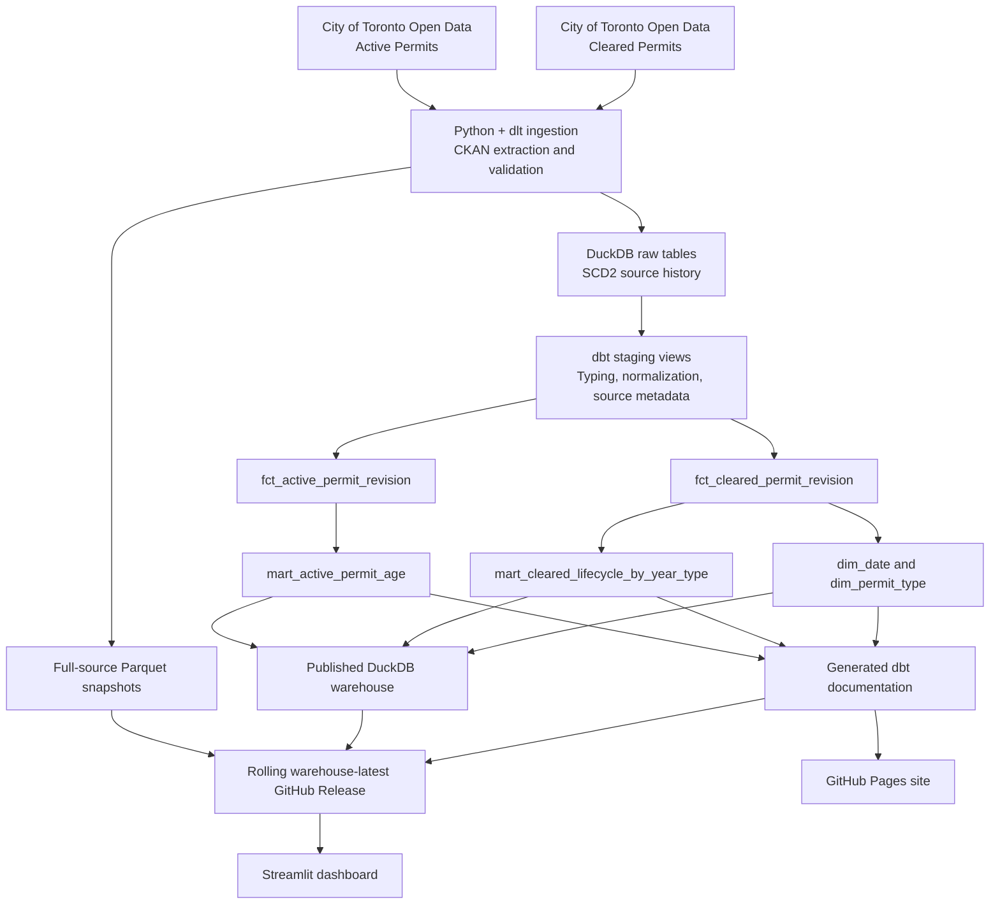
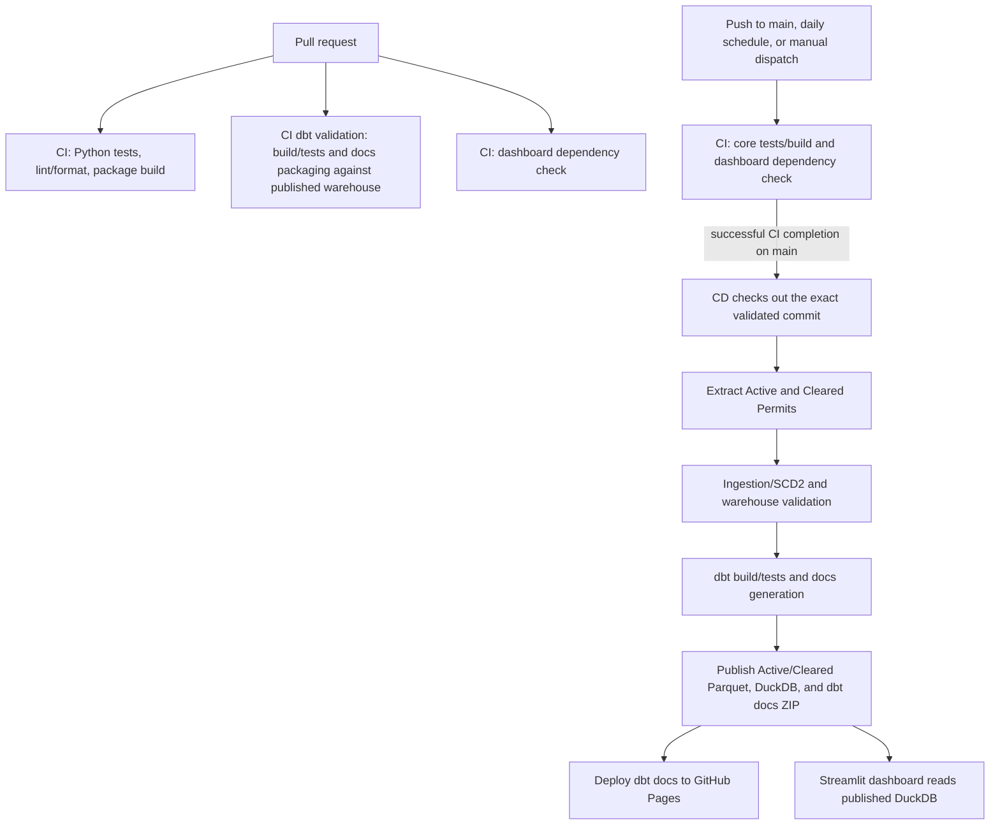

# Toronto Housing Bottleneck Analytics

An end-to-end Analytics Engineering portfolio project built around City of Toronto building-permit data. It demonstrates how to turn evolving public source data into version-aware warehouse tables, documented and tested dbt models, repeatable published data assets, and an interactive analytical dashboard.

**[Live dashboard](https://toronto-housing-bottleneck.streamlit.app/)** · **[Live dbt documentation](https://gagadanalyst.github.io/toronto-housing-bottleneck-analytics/)** · **[GitHub repository](https://github.com/gagadanalyst/toronto-housing-bottleneck-analytics)** · **[Published data assets](https://github.com/gagadanalyst/toronto-housing-bottleneck-analytics/releases/tag/warehouse-latest)**

## The analytical questions

- **Active-permit aging:** How long have permit revisions that are still marked active been open, and how does the observed age vary by permit type?
- **Observed lifecycle durations:** For permits marked `Closed`, how much calendar time elapsed between the application, issue, and completion dates available in the source?
- **Source-data reliability:** How much duplication, missing information, or disagreement exists in the published rows, and how should those issues affect the analytical population?

These are descriptive questions. A snapshot of permit data does not, on its own, establish why a permit took a particular amount of time.

## Project at a glance

| Area | Implementation |
|---|---|
| Sources | City of Toronto Open Data: Active Permits and Cleared Permits |
| Ingestion and history | Python, Toronto CKAN APIs, dlt SCD2, full-source Parquet snapshots |
| Warehouse | DuckDB; raw source tables plus dbt-built relations in the `analytics` schema |
| Transformation | dbt staging views, revision-level fact models, dimensions, analytical marts |
| Data quality | Pytest coverage for ingestion and SCD2 behaviour; dbt unit, schema, relationship, and uniqueness tests; strict static analysis by default; explicit conflict flags and duration exclusions |
| Automation | Separate GitHub Actions workflows: CI validates code and dependencies; CD publishes production assets and deploys dbt docs after successful eligible CI runs on `main` |
| Delivery | Rolling GitHub Release assets, hosted dbt documentation, and a Streamlit dashboard |

## End-to-end architecture



The dimensions are separately modeled and tested; the current serving marts are purpose-built outputs and do not imply that every dimension is joined into every mart.

## Scope and source data

The configured ingestion scope contains exactly two datasets:

- [Active Permits](https://open.toronto.ca/dataset/building-permits-active-permits/) — the current active population used for aging analysis.
- [Cleared Permits](https://open.toronto.ca/dataset/building-permits-cleared-permits/) — permits with cleared outcomes and lifecycle dates used for elapsed-time analysis.

CKAN extraction prefers paginated DataStore API retrieval and supports CSV/JSON fallback resources. Full-source Parquet snapshots are preserved independently of the analytical warehouse cutoff. The warehouse load applies `APPLICATION_DATE >= 2020-01-01` to both configured sources.

Additional datasets were considered during discovery but are not part of the current ingestion scope. The [dataset-selection decision record](docs/decisions/0001-dataset-scope.md) documents the evidence, trade-offs, and validation gates for reconsidering Development Applications, Preliminary Zoning Reviews, and Address Points. These candidates are not treated as integrated sources.

## Analytics engineering and model design

The models make their grain and data-quality handling explicit rather than silently selecting one row when source values disagree.

| Model | Grain / role | Important behaviour |
|---|---|---|
| `stg_active_permits` | One row per raw SCD2 source version | Casts dates and numeric values, retains selected raw values alongside casts, and carries source-version metadata into dbt. |
| `stg_cleared_permits` | One row per raw SCD2 source version | Applies corresponding typing and normalizes the completion timestamp to its UTC calendar date. |
| `fct_active_permit_revision` | One row per current logical revision, keyed by `permit_num`, `revision_num`, and `permit_type` | Consolidates duplicate current source rows; publishes key attributes only when the observed values agree; retains diagnostic values and conflict flags. |
| `fct_cleared_permit_revision` | One row per current logical revision using the same three-column key | Consolidates duplicate current rows, retains signed raw lifecycle intervals, and exposes analysis-facing durations only when the interval is non-negative. |
| `dim_permit_type` | One row per distinct permit type represented in the Cleared fact | The fact-to-dimension relationship is tested for both revision facts. |
| `dim_date` | One row per calendar date across lifecycle dates observed in the Cleared fact | Provides calendar attributes and a continuous date spine. |
| `mart_active_permit_age` | One row per logical current Active revision | Computes elapsed calendar days from application date to a configurable `as_of_date` and carries an explicit eligibility flag and exclusion reason. |
| `mart_cleared_lifecycle_by_year_type` | One row per application year, permit type, and lifecycle measure | Summarizes non-negative durations using median, 90th percentile, and maximum, while separately reporting date-pair counts and negative intervals. |

### Metric and eligibility rules

**Active-permit age** is elapsed calendar days from `application_date` to the model's `as_of_date`. The default as-of date comes from the dbt run start time and can be overridden with the `as_of_date` variable. The age cohort excludes revisions with conflicting or missing status, status values classified as terminal or exceptional (`abandoned`, `cancelled`, or `closed`), conflicting application dates, or missing application dates. Exclusions are reason-coded instead of being silently dropped.

**Cleared-permit lifecycle durations** are elapsed calendar days between application, issue, and completion dates. The summary uses records marked `Closed`, grouped by application year and permit type. Negative intervals remain visible in raw duration fields and quality flags but are excluded from published duration statistics. These are calendar-day measures, not business-day measures.

Selected staging fields preserve their raw source values beside typed values. Current physical rows are grouped to a logical revision only after current SCD2 versions are selected; missing-versus-present values and conflicting values are surfaced through diagnostics instead of being arbitrarily resolved.

## Data-quality snapshot

The following values describe the published warehouse observed on **October 18, 2026**. They are a point-in-time illustration of the checks, not permanent totals; the release is refreshed and these values may change.

| Check | Observed value | Interpretation |
|---|---:|---|
| Active source rows across SCD2 history | 101,598 | Includes historical versions, not just the current source snapshot. |
| Current physical Active source rows | 99,149 | Current SCD2 rows before consolidating duplicate physical rows. |
| Logical current Active revisions | 99,145 | One row per `permit_num` + `revision_num` + `permit_type`; four physical rows are excess duplicates. |
| Active revisions eligible for age analysis | 99,074 | Eligible records after the documented status and application-date checks. |
| Active revisions excluded from age analysis | 71 | Two have missing status; 69 have terminal or exceptional status in this snapshot. |
| Active builder-name conflict groups | 4 | Current physical rows disagree on builder name within the logical revision. |
| Current physical Cleared source rows | 186,430 | Current SCD2 rows before consolidation. |
| Logical current Cleared revisions | 186,425 | One row per logical revision; five physical rows are excess duplicates. |
| Cleared builder-name conflict groups | 5 | Builder-name disagreements are identified rather than silently resolved. |
| Cleared lifecycle-date conflict groups | 0 observed | No disagreements were observed across current source rows for the modeled lifecycle-date fields in this snapshot. |

The fact that source rows or attributes conflict does not automatically mean the entire ingestion run is discarded. The pipeline retains quality signals; dbt models then apply explicit eligibility and publication rules appropriate to each analysis.

## Testing, automation, and publication

GitHub Actions was added **after the initial ingestion pipeline and its core checks were established**. Automation evolved with the project rather than being presented as the starting point.

### Pull-request validation

The workflow validates Python linting and formatting, runs automated tests, audits Python dependencies, and builds the package. It also validates dashboard dependencies. The dbt validation job downloads the latest published warehouse and runs `dbt debug`, `dbt parse`, `dbt build`, and documentation generation/package checks against it. That checks transformation changes against a real published dataset without requiring every pull request to run a full live-source extraction.

### Main-branch publication and scheduled refresh

CI and CD are separate workflows. `ci.yml` runs the core test/build and dashboard-dependency jobs for pull requests and main-branch runs; its dbt-validation job runs on pull requests against the latest published warehouse, including model tests and documentation-packaging checks. CI is scheduled daily at **10:00 America/Toronto** and also supports pushes to `main` and manual dispatches. The separate `cd.yml` workflow listens for CI completion. Its production jobs run only when CI concludes successfully, the originating branch is `main`, and the triggering event was not a pull request. CD checks out the exact commit reported by the completed CI run, then extracts the two configured sources, runs ingestion/SCD2 and warehouse validations, builds and tests dbt models, generates documentation, and publishes the assets. GitHub Pages deployment is a downstream job that starts only after data publication succeeds.



Strict dbt static analysis is enabled by default. The cleared staging model has a documented baseline exception for a DuckDB timezone expression that the analyzer cannot resolve; the exception is retained until a semantics-safe alternative is verified.

The `warehouse-latest` release is a **rolling asset publication**, not a semantic-version release or a history of immutable warehouse snapshots. Its assets are:

- [DuckDB warehouse](https://github.com/gagadanalyst/toronto-housing-bottleneck-analytics/releases/download/warehouse-latest/toronto.duckdb) — source tables plus dbt-built relations.
- [Active Permits Parquet snapshot](https://github.com/gagadanalyst/toronto-housing-bottleneck-analytics/releases/download/warehouse-latest/toronto-active-permits.parquet) — full-source snapshot.
- [Cleared Permits Parquet snapshot](https://github.com/gagadanalyst/toronto-housing-bottleneck-analytics/releases/download/warehouse-latest/toronto-cleared-permits.parquet) — full-source snapshot.
- [dbt documentation archive](https://github.com/gagadanalyst/toronto-housing-bottleneck-analytics/releases/download/warehouse-latest/toronto-dbt-docs.zip) — downloadable copy of the generated static site, including its assets and local viewing instructions.

The [hosted dbt documentation site](https://gagadanalyst.github.io/toronto-housing-bottleneck-analytics/) is deployed to GitHub Pages after successful main-branch data publication. The archive remains available for offline review.

## Published dbt documentation

**[Browse the generated dbt documentation site](https://gagadanalyst.github.io/toronto-housing-bottleneck-analytics/)**

The hosted site exposes the generated dbt model documentation and project metadata. GitHub Actions publishes the static site after a successful main-branch data refresh and dbt build. For offline review, download the [dbt documentation ZIP](https://github.com/gagadanalyst/toronto-housing-bottleneck-analytics/releases/download/warehouse-latest/toronto-dbt-docs.zip), extract it, and run `python3 -m http.server 8000` from the extracted directory before opening `http://localhost:8000/`.

## Live dashboard

**[Explore Toronto Housing Bottleneck Analytics](https://toronto-housing-bottleneck.streamlit.app/)**

The Streamlit app downloads the published `toronto.duckdb` asset from GitHub and queries the `analytics` models read-only. It does not connect live to Toronto's CKAN endpoints. Query results are cached for 24 hours, with a manual refresh option.

The four sections are:

- **Overview** — high-level view of active aging and closed-permit lifecycle measures.
- **Active permits** — age distributions and comparisons by permit type, with record-level details.
- **Permits marked Closed** — date-pair duration comparisons by application year and permit type.
- **Data & definitions** — eligibility and exclusion counts, data-quality checks, metric definitions, and caveats.

The dashboard's summaries intentionally distinguish statistics calculated within each year/type group from statistics over individual permit revisions. This avoids presenting a median of group medians as though it were a median across all underlying permits.

## Review or run the project locally

### 1. Set up Python and run the offline tests

Use Python 3.14.x. From the repository root:

```bash
git clone https://github.com/gagadanalyst/toronto-housing-bottleneck-analytics.git
cd toronto-housing-bottleneck-analytics
python3.14 -m venv .venv
source .venv/bin/activate
python -m pip install --upgrade pip
python -m pip install -e ".[dev]"
python -m pytest -q \
  --ignore=tests/test_warehouse_load.py \
  --ignore=tests/integration/test_scd2_active_permits.py
```

This test command is intended to run without a previously extracted Toronto dataset or a local warehouse. Other tests need captured ingestion data, a warehouse, or network access; see the [test guide](tests/README.md). The end-to-end setup test downloads a full Active Permits source and should be run deliberately.

### 2. Build dbt models against the latest published warehouse

This route lets a reviewer validate the transformation layer without re-running the full ingestion first. Use a **separate dbt virtual environment** to match CI's isolation and keep dbt dependencies separate from the ingestion package. Run from the repository root:

```bash
mkdir -p data/warehouse "$HOME/.venvs"
curl -fL \
  https://github.com/gagadanalyst/toronto-housing-bottleneck-analytics/releases/download/warehouse-latest/toronto.duckdb \
  -o data/warehouse/toronto.duckdb
cp data/warehouse/toronto.duckdb data/warehouse/toronto-dbt-local.duckdb
export DBT_DUCKDB_PATH="$PWD/data/warehouse/toronto-dbt-local.duckdb"
python3.14 -m venv "$HOME/.venvs/toronto-housing-dbt"
source "$HOME/.venvs/toronto-housing-dbt/bin/activate"
python -m pip install --upgrade pip
python -m pip install -r dbt/requirements.txt
cp dbt/profiles.yml.example dbt/profiles.yml
cd dbt
dbt deps --profiles-dir .
dbt build --profiles-dir .
dbt docs generate --profiles-dir . --output-dir target/docs-site
cd ..
```

The copied database is used so a local dbt build does not modify the downloaded release file. To view the generated documentation locally, serve the generated `dbt/target/docs-site` directory with a static HTTP server, for example `python3 -m http.server 8000` from inside that directory, and open `http://localhost:8000/`.

### 3. Run the dashboard locally (optional)

The dashboard pins its own dependency set, including a newer pandas release than the ingestion package, so install it in a **separate virtual environment** rather than mixing dashboard and ingestion dependencies:

```bash
mkdir -p "$HOME/.venvs"
python3.14 -m venv "$HOME/.venvs/toronto-housing-dashboard"
source "$HOME/.venvs/toronto-housing-dashboard/bin/activate"
python -m pip install -r dashboard/requirements.txt
streamlit run dashboard/app.py
```

The app loads the rolling published DuckDB asset from GitHub. It does not require local ingestion data, but it does require network access to download the release asset. The example keeps this virtual environment outside the repository.

## Repository guide

| Path | Purpose |
|---|---|
| `src/toronto_housing_ingestion/` | Python ingestion, extraction, validation, and warehouse-loading code. |
| `open_data_config.yml` | Configured source definitions and ingestion settings. |
| `tests/` | Unit, integration, source-fallback, warehouse, and SCD2 regression tests. |
| `dbt/models/staging/` | Source staging views and column documentation/tests. |
| `dbt/models/marts/` | Revision facts, dimensions, analysis marts, model documentation, and unit tests. |
| `dbt/macros/` | Adapter-dispatched date and aggregation macros. DuckDB is the tested execution target; Snowflake is not an end-to-end configured deployment. |
| `.github/workflows/ci.yml` | Core tests and package build; pull-request dbt validation against the published warehouse; dashboard dependency checks; daily schedule and manual trigger. |
| `.github/workflows/cd.yml` | Post-CI production ingestion and validation, dbt build/tests, rolling asset publication, and gated GitHub Pages deployment. |
| `dashboard/app.py` | Streamlit application. |
| `docs/decisions/0001-dataset-scope.md` | Dataset-selection decision record, evidence, trade-offs, and gates for future expansion. |

## Limitations and interpretation guardrails

- **Active ages are right-censored observations.** The permit is still marked active in the current source; its final issue or completion time is not yet known from that record.
- **The Closed cohort is selected by its recorded status.** It should not be treated as a complete or unbiased representation of all permit applications, and recent application years are especially affected by closure-selection bias.
- **2026 is a partial year.** Comparisons with complete years need caution.
- **Durations are calendar days, not business days.** Negative date intervals are retained for diagnosis and excluded from published duration statistics.
- **Source history is not a complete event ledger.** SCD2 preserves changes observed across ingestion runs; it cannot reconstruct status transitions that were never present in the source snapshots.
- **Source quality varies.** Repeated physical rows, missing attributes, special statuses, and conflicting values may affect the eligible cohort. These cases are counted or flagged explicitly.
- **The latest data assets roll forward.** The current release is not a point-in-time archive of every prior warehouse state; dashboard outputs can change after refreshes.
- **This is descriptive analysis, not causal inference.** The data alone do not identify why an application or permit took longer.

## Project timeline and development practice

- **By September 27, 2026 UTC:** earliest preserved project artifacts show that exploratory and ingestion work was already underway.
- **October 4, 2026 UTC:** first public Git commit in the repository history.
- **October 16, 2026:** GitHub Actions validation and data-asset publication were introduced after the initial ingestion workflow and core checks had been established.
- **October 18, 2026 (Toronto time):** dbt warehouse validation and documentation-packaging checks were added to pull-request CI; the Streamlit dashboard and hosted dbt documentation were deployed. The CI/CD split was also merged and verified end to end: [post-merge CI run #35](https://github.com/gagadanalyst/toronto-housing-bottleneck-analytics/actions/runs/39179649087) and [CD run #1](https://github.com/gagadanalyst/toronto-housing-bottleneck-analytics/actions/runs/39179772013) both succeeded, and all four rolling release assets were refreshed.

The preserved-artifact date and the start of public Git history are deliberately distinguished. From the earliest preserved artifacts to the deployed dashboard was roughly a three-week calendar progression; that is not a measure of hands-on hours.

## Use of AI-assisted development

I used large language models as development aids to explore implementation options, explain concepts, draft or refine code and documentation, and troubleshoot issues. I evaluated suggestions, made scope and implementation decisions, and ran the relevant validation workflows. Analytical definitions and published interpretations are grounded in source documentation, SQL/dbt model logic, tests, and observed outputs; model-generated suggestions were not treated as evidence on their own. I am responsible for the final implementation and claims.

## Potential next steps

- Add dbt Semantic Layer assets—semantic models, metrics, and MetricFlow—after the underlying metric definitions and consumption needs are sufficiently stable.
- Consider additional datasets only after profiling demonstrates acceptable grain, key quality, linkage coverage, and join cardinality.
- Evaluate a Snowflake target as a separate portability exercise; current end-to-end validation and publication use DuckDB.
