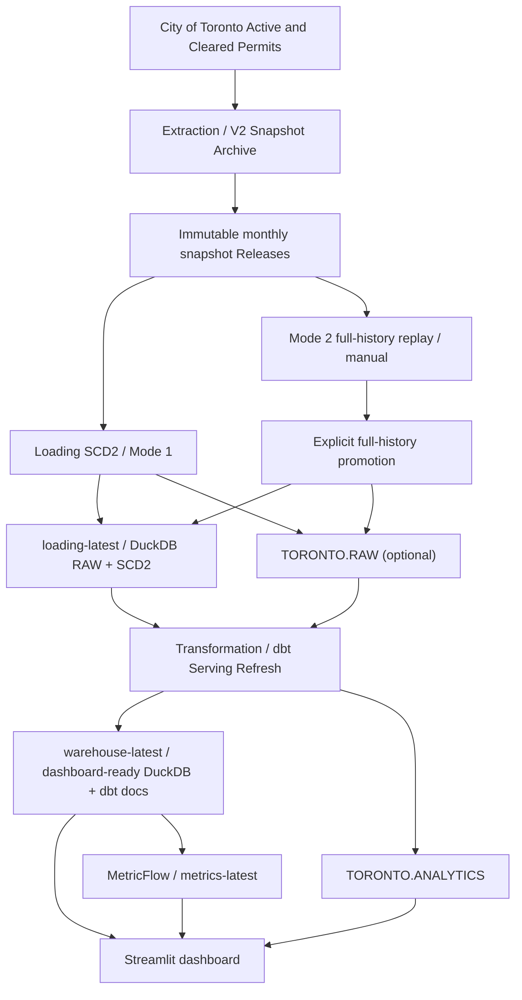
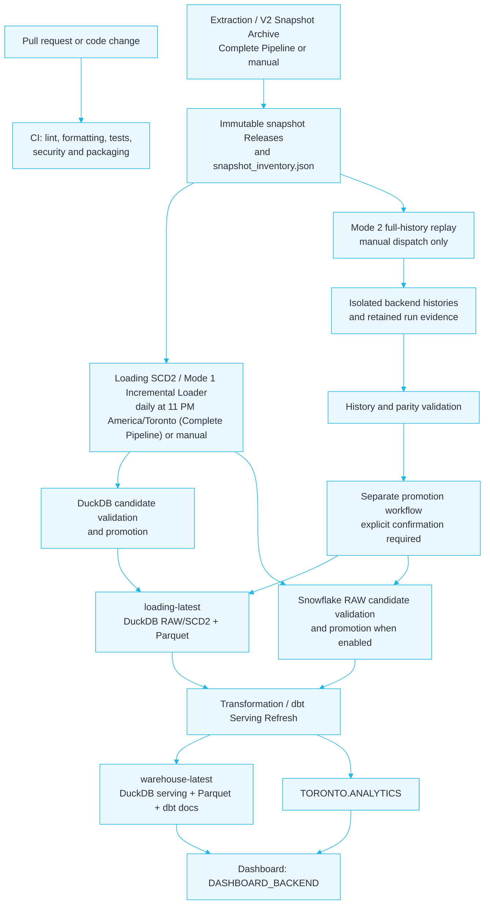

# Toronto Housing Bottleneck Analytics — Snowflake + DuckDB

An end-to-end Analytics Engineering project built on City of Toronto building-permit data. It combines a validated Python extraction pipeline, immutable source archives, isolated incremental and historical warehouse-loading paths, a shared dbt analytics layer, and a deployed Streamlit data product. **DuckDB and Snowflake are supported warehouse backends.** A separate, pinned MetricFlow workflow validates dbt v2 semantic definitions and publishes precomputed Active and Cleared metrics from the published DuckDB warehouse for the dashboard's fifth page; MetricFlow is not a public-dashboard runtime dependency.

**[Live dashboard](https://toronto-housing-bottleneck.streamlit.app/)** · **[dbt documentation](https://gagadanalyst.github.io/toronto-housing-bottleneck-analytics/)** · **[MetricFlow implementation guide](metricflow/README.md)** · **[Snowflake operations guide](infra/snowflake/README.md)** · **[Published DuckDB and snapshots](https://github.com/gagadanalyst/toronto-housing-bottleneck-analytics/releases/tag/warehouse-latest)**

## Analytical questions this project answers

Using current logical Active permit revisions and records marked `Closed`, the dashboard investigates:

1. **How is the current Active permit backlog distributed across application years and permit types?** Compare eligible and ineligible revisions and see how the backlog varies by cohort.

2. **How old are eligible Active permits?** Examine age distributions, median and 90th-percentile age, and counts of records older than 365, 730, and 1,095 calendar days.

3. **Where is the older Active backlog concentrated?** Identify application-year cohorts and permit types contributing the largest counts of permits aged more than 365 days.

4. **For matched permits recorded as `Closed`, how much calendar time elapses between application, issuance, and completion?** Compare counts, median, and 90th-percentile durations for application-to-issue, issue-to-completion, and application-to-completion intervals using the same matched cohort.

5. **How do Closed-permit lifecycle intervals vary by application year and permit type?** Compare lifecycle measures across the corresponding year/type cohorts.

6. **What data-quality conditions affect these measures?** Examine missing and conflicting fields, unusable or out-of-order dates, and exclusions from the Active-age and matched Closed cohorts.

**Start with the findings.** The Story page leads with the current Active backlog, its one-year-plus share, the concentration of older records among the five largest permit types, the share from recent application cohorts, and pooled Closed lifecycle medians / P90s. Each headline is calculated from the selected warehouse and displayed with its measurement date; the README deliberately avoids copying live KPIs that would become stale.

**Interpretation guardrails.** Each observation is a building-permit revision, not a home or dwelling unit. Active age is elapsed calendar days from application date to the analysis `as_of_date`; these are ongoing, right-censored ages, not final processing times. The pooled matched Closed lifecycle analysis uses records with all three dates present and chronological order (`application_date <= issued_date <= completed_date`). The broader Closed-permit timelines page evaluates each date pair independently and excludes negative intervals from published duration statistics. Both describe selected records, not all applications. These are descriptive comparisons, not causal explanations of processing time, housing supply, affordability, or the wider development pipeline.

## What the project demonstrates

| Area | What is implemented |
|---|---|
| Extraction and provenance | A standalone Python extraction application, Toronto CKAN API checks, source typing, completeness validation, Parquet snapshot bundles, immutable Releases, and a maintained snapshot inventory. |
| Incremental production loading | Loading SCD2 / Mode 1 replays only unprocessed approved archives into isolated DuckDB and optional Snowflake RAW candidates, validates each candidate, checks its production baseline, and promotes to the separate loading baseline. |
| Transformation | The independent dbt workflow builds/tests serving models from the promoted Loading baseline and publishes the dashboard-ready DuckDB warehouse and Snowflake ANALYTICS candidate. |
| Historical reconstruction | Mode 2 is a separate manual-only full-history replay and parity path. It produces isolated reconstruction evidence; a different workflow performs explicitly authorized production promotion. |
| Warehouse history | SCD Type 2 tracking for source changes observed between retained snapshots. This is observed history, not a complete real-world event ledger. |
| Analytics engineering | One dbt project for DuckDB and Snowflake, with staging models, revision-level facts, dimensions, marts, contracts, tests, and documentation. |
| Semantic metrics | dbt v2 model-embedded semantic definitions for Active and Cleared permit revisions, queried by an isolated MetricFlow workflow and published as six reusable result groups. |
| Reliability | Persistent incremental-loader state, immutable source archives, candidate validation, SCD2 and quarantine checks, baseline verification, independent backend promotion, and recovery procedures. |
| Data product | A deployed five-page Streamlit dashboard: four existing interactive analytics pages plus a MetricFlow results page, with explicit DuckDB/Snowflake selection for the warehouse-backed views. |

The analysis is descriptive, not causal. It examines observed active-permit ages and dates recorded for permits marked `Closed`; it does not claim to explain why a permit took a given amount of time.

## Architecture




Extraction / V2 Snapshot Archive is the immutable-evidence boundary. It publishes validated source bundles and updates `snapshot_inventory.json`; it does not load either warehouse. Loading SCD2 / Mode 1 consumes approved, unprocessed archives and promotes isolated DuckDB and optional Snowflake RAW candidates. DuckDB Loading publishes a separate `loading-latest` baseline; its first publication is seeded once from the verified existing `warehouse-latest`, and later runs restore only `loading-latest`. Loading performs source, ledger, DLT, SCD2, quarantine and production-baseline validation, but no dbt execution.

Transformation / dbt Serving Refresh restores the exact `loading-latest` baseline, builds and tests dbt, validates dashboard relations, records refresh metadata, and publishes the four-asset `warehouse-latest` release. A dbt-only code change starts Transformation without Extraction or Loading. Snowflake RAW and ANALYTICS remain separate promotion boundaries; Transformation dispatches the isolated serving-schema build after successful RAW promotion. An explicitly approved Mode 2 full-history promotion also updates `loading-latest` and then dispatches Loading with `rebootstrap_from_mode2=true` and the exact source run/attempt, so the persistent Mode 1 archive ledger is reset to that promoted generation before Transformation.

Complete Pipeline / Extraction + Loading + Transformation runs at 11 PM `America/Toronto` or on explicit manual dispatch. It starts Extraction; Loading follows Extraction completion even if extraction failed or found no changes, so older unprocessed archives are still considered. Loading-specific code changes start Loading; Transformation follows a successful, validated Loading handoff, including applicable initial-baseline persistence and Mode 2 rebootstrap paths. dbt-only changes start Transformation only. MetricFlow follows successful DuckDB serving publication by Transformation.


The archive history is bounded by the snapshots actually retained. Reconstructing all retained archives does not establish a complete real-world permit event history or recover changes that were never captured in a snapshot. SCD2 validity windows describe observed source changes between snapshots.

MetricFlow is a separate semantic-metrics publication path, not another warehouse loader. After Transformation explicitly dispatches it following a successful DuckDB publication, its workflow validates the dbt v2 semantic definitions, executes the configured metric queries against the published DuckDB warehouse, and publishes a versioned JSON package in the `metrics-latest` GitHub Release. Pull-request validation uses a disposable restored database and does not publish results; manual backfill can target an already successful Transformation DuckDB publication. The MetricFlow environment is isolated from the production dbt and Streamlit dependencies.

`SNOWFLAKE_OPERATIONS_ENABLED` controls Snowflake workflow operations; it does not choose the dashboard backend. `DASHBOARD_BACKEND` chooses which warehouse the same dashboard reads. The app defaults to DuckDB when the setting is omitted, and a connection failure is shown rather than silently substituting results from the other warehouse.

## Source scope and analytical design

The current ingestion scope is limited to two City of Toronto datasets: [Active Permits](https://open.toronto.ca/dataset/building-permits-active-permits/) and [Cleared Permits](https://open.toronto.ca/dataset/building-permits-cleared-permits/). Both source configurations use `warehouse_since: 2020-01-01` on `APPLICATION_DATE`; full-source Parquet snapshots are retained independently of that warehouse cutoff.

The project deliberately does not ingest Development Applications, Preliminary Zoning Reviews, or Address Points. Those were considered during discovery but remain deferred until profiling shows that their grain, identifiers, linkage coverage, and join cardinality support reliable analysis. The [dataset-scope decision record](docs/decisions/0001-dataset-scope.md) explains the trade-offs.

| Model | Grain and purpose |
|---|---|
| `stg_active_permits`, `stg_cleared_permits` | One row per raw SCD2 source version; casts source fields while retaining selected raw values and version metadata. |
| `fct_active_permit_revision` | One row per current logical revision keyed by `permit_num`, `revision_num`, and `permit_type`; consolidates duplicate physical rows and surfaces disagreements. |
| `fct_cleared_permit_revision` | Same logical key; preserves signed lifecycle intervals and exposes analysis durations only when non-negative. |
| `dim_date` | Continuous calendar date dimension for dates observed in the Cleared fact. |
| `dim_permit_type` | Distinct permit types observed in either source fact, tested against both revision facts. |
| `mart_active_permit_age` | Current Active revisions with age, an eligibility flag, and a reason-coded exclusion. |
| `mart_active_backlog_by_year_type` | Current Active backlog counts by application year and permit type, including age eligibility, >365/730/1,095-day counts, and age summary statistics. |
| `mart_cleared_lifecycle_by_year_type` | Calendar-day lifecycle summaries by application year, permit type, and date pair; reports median, 90th percentile, maximum, counts, and negative intervals. |
| `mart_cleared_lifecycle_matched_by_year_type` | Matched Closed lifecycle intervals by application year, permit type, and measure, using records with all three dates present and chronologically ordered. |

The dimensions are separately modeled and tested; the serving marts are purpose-built outputs and do not imply that every dimension is joined into every mart. Strict dbt static analysis is enabled by default. The Cleared staging model keeps a documented baseline exception because the analyzer cannot resolve DuckDB's timezone expression without a verified semantics-safe alternative.

**Metric rules.** Active age is calendar days from `application_date` to dbt's `as_of_date` (normally derived from the run start, with a variable for reproducible comparisons). Missing or conflicting status/application dates, and terminal or exceptional statuses (`abandoned`, `cancelled`, `closed`), are excluded from the age cohort with reason codes. The Active backlog mart retains eligible and ineligible counts but calculates age thresholds and age statistics only for eligible records. The matched Closed lifecycle cohort requires all three dates and chronological order (`application_date <= issued_date <= completed_date`), so all three intervals use the same denominator. The broader Cleared lifecycle mart retains signed intervals for diagnosis; published duration statistics exclude negative intervals. Measures are calendar days, not business days.

## Source-data challenges and how they were handled

The project encountered both CKAN service instability and source-data conditions that could distort analysis. The table separates observed source/API behaviour from the safeguards added in extraction and modelling.

| Issue | How it was identified | Handling | Why it matters |
|---|---|---|---|
| CKAN endpoint failures across DataStore and JSON resources (HTTP 409, 500 and 502 were observed) | API request logs, failed DataStore page reads and JSON-resource fetches. | Retry selected transient status codes, try supported alternate CSV/JSON resource routes and validate the response; stop extraction if no route produces a complete valid snapshot. | A failed source endpoint does not become a silently incomplete snapshot. |
| Changing or estimated pagination totals | Compare the page-level `total`, observed rows and final Parquet row count; inspect source cache / modification markers. | Restart a changing, non-estimated pull from offset zero at most twice; for estimated totals, continue until an empty page. Validate the finished row count and discard a snapshot if reliable source markers change during extraction. | Prevents mixed or partial snapshots when the live dataset changes during pagination. |
| Identifiers and numeric-looking text | Schema profiling, leading-zero regression fixtures, and detection of JSON values that arrive as numbers for text fields. | Explicit source types and CSV dtypes preserve identifiers as text; non-string JSON values for text fields are rejected rather than coerced lossily. | Keeps permit and revision identifiers stable, including leading zeros. |
| Unstable CKAN `_id` and duplicate physical rows | Repeated-snapshot SCD2 comparisons, business-key checks and revision-level reconciliation. | Use `permit_num` + `revision_num` + `permit_type` as the logical key; exclude `_id` from change hashing. Consolidate physical rows, flag conflicting attributes and quarantine conflicting SCD2 business-key groups before loading. | Avoids false SCD2 changes and prevents ambiguous duplicate keys entering clean history. |
| Missing, conflicting or out-of-order lifecycle dates | Date completeness, source-value conflict and negative-interval checks in the Cleared fact and quality mart. | Withhold conflicting dates, retain signed raw intervals for diagnosis, and exclude only the invalid date-pair duration from its measure. The matched cohort requires all three dates in chronological order. | Keeps cohort denominators and lifecycle statistics interpretable without discarding unrelated valid intervals. |

## Important findings and decisions

- **Source reliability and quality are handled explicitly.** The source-data table above records the observed CKAN/API failures, typing hazards, unstable row identifiers, duplicate keys and lifecycle-date anomalies, alongside the detection and mitigation for each.
- **Extraction and warehouse loading are separate responsibilities.** The V2 Snapshot Archive workflow produces validated, immutable Active and Cleared snapshot bundles. Mode 1 and Mode 2 consume approved archives; neither needs to re-extract Toronto's source data to replay a retained snapshot.
- **SCD2 versions should represent meaningful changes.** The logical revision key is `permit_num` + `revision_num` + `permit_type`. The tracked-row hash excludes CKAN's `_id` and normalizes selected numeric fields to avoid false versions caused by source identity or representation. Regression checks cover unchanged replay and a controlled tracked-attribute change ([SCD2 test PR](https://github.com/gagadanalyst/toronto-housing-bottleneck-analytics/pull/76)).
- **Mode 2 reconstructs the retained archive history.** The accepted historical reconstruction used 28 retained source snapshots, with isolated DuckDB/Snowflake replay, ledger and DLT checks, and history parity before the separate promotion. The fixed historical archive boundary is provenance, not a moving daily counter. Snapshots still do not reveal transitions that occurred between captures.
- **Mode 1 is the routine incremental production path.** Its backend jobs use isolated candidates and persistent working state. Source completeness, business-key and duplicate checks, SCD2 integrity, quarantine reconciliation, and production-baseline verification precede promotion. A failed candidate does not become the next production baseline.
- **Backend promotion is independent.** DuckDB and Snowflake do not share a distributed transaction. The Snowflake job is separately gated; disabling Snowflake does not disable the DuckDB Mode 1 path or immutable source archive publication.
- **The dashboard and workflow gates are separate controls.** `DASHBOARD_BACKEND` selects the dashboard's data source. `SNOWFLAKE_OPERATIONS_ENABLED` controls whether Snowflake workflow jobs may run. Switching the dashboard to DuckDB alone does not disable GitHub Actions compute.

## Data-quality snapshot

These source and model counts describe the published DuckDB warehouse observed on **October 18, 2026**. They are a historical illustration of the checks, not current dashboard totals or expected permanent counts. The live dashboard calculates its KPIs from whichever backend is selected at runtime.

| Check | Observed value | Meaning |
|---|---:|---|
| Active source rows across SCD2 history | 101,598 | Includes current and expired versions. |
| Current physical Active rows | 99,149 | Before consolidating duplicate physical rows. |
| Logical current Active revisions | 99,145 | One per logical revision key. |
| Active revisions eligible for age analysis | 99,074 | After the published status/date rules. |
| Active revisions excluded from age analysis | 71 | 2 missing status; 69 terminal or exceptional status. |
| Active builder-name conflict groups | 4 | Conflicting values retained as diagnostics. |
| Current physical / logical Cleared revisions | 186,430 / 186,425 | Five excess physical rows after consolidation. |
| Cleared builder-name conflict groups | 5 | Conflicts are surfaced rather than arbitrarily resolved. |
| Cleared lifecycle-date conflict groups | 0 observed | No conflict found for the modeled lifecycle-date fields in that snapshot. |

## Validation evidence

The following results are tied to specific workflow runs and inputs; they are not guarantees about later refreshes. Several linked runs predate the Mode 1 / Mode 2 separation and are retained as historical evidence, not as descriptions of the current workflow topology.

| Validation | Evidence |
|---|---|
| Post-recovery reliability validation (November 9, 2026) | On merge commit [`6999487`](https://github.com/gagadanalyst/toronto-housing-bottleneck-analytics/commit/69994872b36df99970d734abeaad9b9bd6dc2444), [main CI](https://github.com/gagadanalyst/toronto-housing-bottleneck-analytics/actions/runs/42612234201), [secret scan](https://github.com/gagadanalyst/toronto-housing-bottleneck-analytics/actions/runs/42612231561), [CD / DuckDB publication](https://github.com/gagadanalyst/toronto-housing-bottleneck-analytics/actions/runs/42612402884), [Snowflake RAW refresh](https://github.com/gagadanalyst/toronto-housing-bottleneck-analytics/actions/runs/42612648618), and [Snowflake serving build](https://github.com/gagadanalyst/toronto-housing-bottleneck-analytics/actions/runs/42613324641) all succeeded. CD validated and promoted its DuckDB candidate, published the immutable recovery checkpoint and rolling assets, and deployed dbt documentation. The RAW workflow validated and promoted its isolated candidate, then dispatched the serving build; serving verified its upstream RAW run, dbt models, dashboard relations, metadata, and read access before promotion. This is dated run evidence, not a guarantee about later refreshes. |
| Earlier automated refresh (November 2, 2026) | On commit [`bf27af2`](https://github.com/gagadanalyst/toronto-housing-bottleneck-analytics/commit/bf27af2cfc8e99936777a0332b752981da4de81a), [CI #124](https://github.com/gagadanalyst/toronto-housing-bottleneck-analytics/actions/runs/41396261400), [CD #92](https://github.com/gagadanalyst/toronto-housing-bottleneck-analytics/actions/runs/41396374837), [Snowflake RAW #37](https://github.com/gagadanalyst/toronto-housing-bottleneck-analytics/actions/runs/41396850955), and [Snowflake serving #38](https://github.com/gagadanalyst/toronto-housing-bottleneck-analytics/actions/runs/41397052684) succeeded. The serving build passed 52/52 dbt resources and verified 98,591 current logical Active revisions, 189,857 current logical Cleared revisions, and 300 lifecycle-summary groups (288,448 logical revisions combined). These are counts from that refresh, not permanent expected totals. |
| Fresh-baseline SCD2 behaviour | The [successful Snapshot Baseline and Replay run](https://github.com/gagadanalyst/toronto-housing-bottleneck-analytics/actions/runs/40491637116), added in [PR #76](https://github.com/gagadanalyst/toronto-housing-bottleneck-analytics/pull/76), verified that an unchanged replay added no versions and a controlled `STATUS` change created the expected version. |
| DuckDB/Snowflake parity | [Run 40482009588](https://github.com/gagadanalyst/toronto-housing-bottleneck-analytics/actions/runs/40482009588), using `as_of_date=2026-10-27`: compared dimensions, facts, and marts had zero row-value mismatches, and dashboard summary metrics matched. Staging was compared on schema, grain/count, and semantic types rather than row by row. |
| Automatic refresh chain | On commit [`e8bb994`](https://github.com/gagadanalyst/toronto-housing-bottleneck-analytics/commit/e8bb994c8ec664d2da7d12d1c296a1b15da3dc49), [CI](https://github.com/gagadanalyst/toronto-housing-bottleneck-analytics/actions/runs/40622105661), [CD/publication](https://github.com/gagadanalyst/toronto-housing-bottleneck-analytics/actions/runs/40622186735), [canonical RAW refresh](https://github.com/gagadanalyst/toronto-housing-bottleneck-analytics/actions/runs/40622867433), and [serving build](https://github.com/gagadanalyst/toronto-housing-bottleneck-analytics/actions/runs/40623059248) all succeeded on **October 27, 2026, Toronto time**. RAW and serving runs triggered automatically in sequence. |
| Gate-off / DuckDB fallback | On October 28, 2026, the GitHub variable was set to `false`. [Manual CI](https://github.com/gagadanalyst/toronto-housing-bottleneck-analytics/actions/runs/40630130221) and [the resulting CD publication](https://github.com/gagadanalyst/toronto-housing-bottleneck-analytics/actions/runs/40630228426) succeeded on the same commit. The automatically triggered [RAW refresh](https://github.com/gagadanalyst/toronto-housing-bottleneck-analytics/actions/runs/40631433875) and [serving build](https://github.com/gagadanalyst/toronto-housing-bottleneck-analytics/actions/runs/40631450406) skipped as intended. The project owner confirmed the public dashboard loaded successfully after switching `DASHBOARD_BACKEND` to `duckdb`. |

For the parity run, `MART_ACTIVE_PERMIT_AGE` had 98,869 rows (98,798 eligible and 71 excluded), `FCT_CLEARED_PERMIT_REVISION` had 188,819 rows, and the lifecycle mart had 300 summary groups. The comparison covered 481,927 lifecycle date pairs before excluding three negative intervals from duration statistics. These counts belong to that isolated parity baseline, not a later canonical RAW refresh. The parity job on PR #82 was skipped because the Snowflake workflow gate was off during that PR; the separately linked parity run provides the comparison evidence.

## Automation, publication, and operating controls

The current operational design separates Extraction, Loading SCD2, and Transformation, with Complete Pipeline orchestrating the routine path and Mode 2 retained as a manual full-history recovery path. Extraction retains immutable source evidence; Loading validates and promotes DuckDB/Snowflake RAW history; Transformation builds and promotes dashboard-serving models.



- **CI** validates code changes through linting, formatting, tests, dependency/security checks, and packaging. It is not the production extraction or warehouse-loading workflow.
- **Extraction / V2 Snapshot Archive** runs as the first stage of Complete Pipeline at 11 PM `America/Toronto`, or on explicit manual dispatch. It validates and publishes paired Active/Cleared bundles to immutable Releases and updates `snapshot_inventory.json`; it does not load or transform either warehouse.
- **Loading SCD2 / Mode 1** follows Extraction completion even when extraction failed or found no changes. It can also be dispatched manually and starts on Loading-specific code changes. It consumes approved unprocessed archives, restores the independent `loading-latest` DuckDB baseline, validates and promotes each backend independently, and keeps retryable state under `toronto-mode1-working-state`. A first-run seed copies the existing verified warehouse into `loading-latest` exactly once.
- **Transformation / dbt Serving Refresh** starts after a successful, validated Loading handoff (including applicable initial-baseline persistence and Mode 2 rebootstrap paths), on dbt-specific code changes, or on manual dispatch. It restores `loading-latest`, builds and tests dbt, validates dashboard relations and refresh metadata, and publishes the four-asset `warehouse-latest` serving release plus GitHub Pages documentation. A failed refresh leaves the previous dashboard-serving release unchanged.
- **Snowflake RAW and serving** are separate promotion boundaries. Loading promotes its isolated RAW candidate to `TORONTO.RAW`; Transformation dispatches the isolated serving workflow after a successful RAW promotion, builds/tests dbt in a candidate schema, verifies dashboard relations, metadata and grants, then promotes to `TORONTO.ANALYTICS`.

- **Mode 2 full-history reconstruction** is the manual-only `snapshot-replay.yml` workflow, named `Snapshot Loader (Full-History Rebuild and Parity)`. It replays the selected retained archive history into isolated targets, preserves retry/evidence artifacts, and compares histories when both backends are selected and available. It does not perform production promotion or routine daily loading.
- **Explicit Mode 2 promotion** is handled by `promote-snapshot-rebuild.yml`. It verifies the source replay run, required job/evidence artifacts, and the `loading-latest` SCD2 baseline, then requires `confirm_full_history_promotion=true`. The DuckDB promotion updates `loading-latest`, not `warehouse-latest`. After promotion it dispatches Loading with `rebootstrap_from_mode2=true` and the exact source run/attempt; Transformation then rebuilds the dashboard warehouse and optional Snowflake serving.
- **Snowflake operational gate.** The exact repository variable value `SNOWFLAKE_OPERATIONS_ENABLED=true` enables the guarded Snowflake operations. It applies to the Mode 1 Snowflake job, Snowflake serving, the Snowflake side of Mode 2 replay/comparison and promotion, and the remaining manual, non-production Snowflake smoke workflow (`snowflake.yml`). If false or unset, Snowflake jobs skip before connecting. The gate does not disable source archive extraction or the DuckDB Mode 1 job, and it does not cancel a Snowflake job already running.
- **Legacy loader safety guard.** The Mode 1 workflow refuses to proceed if the retired `TORONTO_SNAPSHOT_LOADER_ENABLED` variable is `true`. Keep that legacy variable false or unset; it is not the switch that enables the current Mode 1 workflow.
- **Independent backend boundary.** DuckDB and Snowflake promote independently; there is no distributed transaction across the engines. A failure in one backend does not roll back a successful promotion in the other. A Snowflake RAW promotion can succeed while its separate serving build fails; in that case retry serving, not the already successful RAW load.
- **Dashboard backend.** `DASHBOARD_BACKEND` chooses `duckdb` or `snowflake` independently of `SNOWFLAKE_OPERATIONS_ENABLED`. The app defaults to DuckDB when the setting is omitted. A connection/query error is shown rather than silently substituting data from the other backend.

For a planned Snowflake shutdown, set `SNOWFLAKE_OPERATIONS_ENABLED` to `false` or remove it, separately set the deployed Streamlit `DASHBOARD_BACKEND` to `duckdb`, check for already-running Snowflake jobs, and verify a successful DuckDB Mode 1 publication and dashboard read. Archive extraction and DuckDB loading remain independent. Trial expiry and resource monitors are not substitutes for disabling the workflow gate.

## Repository security and local credentials

The `secret-scan.yml` workflow runs Gitleaks on pull requests, pushes to `main`, manual dispatches, and a weekly schedule. Local Streamlit secrets (`.streamlit/secrets.toml`) and common private-key file extensions are ignored by Git. The ignore rules do not remove files already committed.

For a deliberate local file and full-history audit, install Gitleaks and run:

```bash
gitleaks dir . --redact
gitleaks git . --redact --log-opts="--all"
```

If a real credential is detected, treat it as exposed and rotate/revoke it; deleting the line from the latest revision is not enough to make a historical secret safe.

## Live dashboard

**[Open the dashboard](https://toronto-housing-bottleneck.streamlit.app/)**. The dashboard supports both DuckDB and Snowflake; `DASHBOARD_BACKEND` selects the source (`duckdb` or `snowflake`). If neither the environment variable nor the Streamlit secret is set, the app defaults to DuckDB. Both paths query the same dbt analytical relations rather than calling Toronto CKAN directly. Connection or query errors are shown rather than silently switching backends. The four warehouse-backed pages cache data for up to 24 hours; the precomputed MetricFlow result package has its own 15-minute cache. Both can be refreshed manually. The sidebar's last-successful-refresh timestamp is displayed in Toronto local time (ET) and comes from the last successful DuckDB publication or the Snowflake refresh-metadata table. If a DuckDB refresh fails before publication, its unpromoted timestamp does not replace the timestamp in the published artifact. The dashboard has five pages, each with a distinct analytical purpose:

- **The story** — decision-oriented overview of current Active backlog size, age and older-record concentration. It leads with dated headline signals, shows backlog by application year and permit type, includes a joint year × type heatmap, and compares pooled lifecycle durations for a matched Closed cohort.
- **Active permits** — interactive exploration of ongoing Active-permit ages by permit type, including distributions, median and 90th-percentile age, and individual permit-revision details. Filters allow the viewer to narrow the analysis by permit type and age.
- **Closed-permit timelines** — lifecycle comparisons for records marked `Closed`, by application year, permit type and date interval. This page uses the broader lifecycle mart and reports date-pair counts, usable non-negative duration counts, and group-level duration summaries.
- **Data quality & definitions** — logical-revision findings, Active age exclusions, Cleared date completeness, and a reconciled funnel from all current Cleared revisions to Closed records and the matched three-date lifecycle cohort.
- **Metrics & semantic layer** — centrally defined Active and Cleared metrics, displayed overall and by permit type and application year. This page consumes precomputed results from the `metrics-latest` release rather than executing MetricFlow in the Streamlit process.

**How the semantic page relates to the other four.** The first four pages retain their existing dbt serving-mart and dashboard calculation paths; they have not been migrated to MetricFlow. The Active page reads `mart_active_permit_age` (also the source model for its semantic definition) and calculates its filter-responsive statistics in Pandas, including an exact P90. MetricFlow lets visitors select count, eligible count, median age or approximate P90 for the grouped permit-type and application-year views. Cleared interval selectors also expose valid-record counts, making the denominator explicit for each median and approximate P90. The Closed-permit timelines page reads `mart_cleared_lifecycle_by_year_type`, which contains application-year/permit-type group summaries. MetricFlow instead defines lifecycle measures on `fct_cleared_permit_revision` at logical permit-revision grain. Those outputs answer related questions but are not interchangeable: their cohorts, grouping and aggregation levels differ. The Story and Data quality pages also continue to use their existing dbt marts.

**Current semantic-layer scope.** MetricFlow currently queries the published DuckDB warehouse only. The Metrics & semantic layer page reads that DuckDB-generated result package regardless of the dashboard's `DASHBOARD_BACKEND` setting; selecting Snowflake for the existing warehouse-backed pages does not switch MetricFlow execution to Snowflake.

**How to interpret the two lifecycle views.** The Story page calculates pooled median and 90th-percentile durations across individual permit revisions in one matched Closed cohort: all three dates must be present and chronologically ordered. The Closed-permit timelines page uses the broader lifecycle mart, which summarizes records within application-year and permit-type groups. Its displayed median of group medians and median of group 90th percentiles are summaries of group-level statistics, not pooled permit-level median and P90 values. The two views therefore answer related questions but use different cohorts and aggregation levels.

The "revisions with findings" KPIs count each logical revision once; per-check counts can overlap and should not be added. Active age exclusions are reported separately from data-quality findings. Cleared checks cover all current statuses, and date completeness separates conflicting values from missing or unusable values. For the matched Closed lifecycle cohort, conflict, missing-date and out-of-order exclusions are mutually exclusive and reconcile to all revisions marked `Closed`. A populated completion date is a source value, not confirmation that a permit is marked `Closed`.

## Review the project locally

Python **3.14.x** is used for ingestion and tests. From the repository root:

```bash
git clone https://github.com/gagadanalyst/toronto-housing-bottleneck-analytics.git
cd toronto-housing-bottleneck-analytics
python3.14 -m venv .venv
source .venv/bin/activate
python -m pip install --upgrade pip
python -m pip install -e ".[dev]"
python -m pytest -q \
  --ignore=tests/test_warehouse_load.py \
  --ignore=tests/integration/test_scd2_active_permits.py
```

That test command is intended to run without a locally extracted Toronto dataset or warehouse. Other tests may require captured data, a warehouse, or network access; see the [test guide](tests/README.md). The full end-to-end setup test downloads a source dataset and should be run deliberately.

To build dbt against the latest published warehouse, use a **separate dbt virtual environment** and a copy of the database so you do not modify the downloaded release asset:

```bash
mkdir -p data/warehouse "$HOME/.venvs"
curl -fL \
  https://github.com/gagadanalyst/toronto-housing-bottleneck-analytics/releases/download/warehouse-latest/toronto.duckdb \
  -o data/warehouse/toronto.duckdb
cp data/warehouse/toronto.duckdb data/warehouse/toronto-dbt-local.duckdb
export DBT_DUCKDB_PATH="$PWD/data/warehouse/toronto-dbt-local.duckdb"
python3.14 -m venv "$HOME/.venvs/toronto-housing-dbt"
source "$HOME/.venvs/toronto-housing-dbt/bin/activate"
python -m pip install --upgrade pip
python -m pip install -r dbt/requirements.txt
cp dbt/profiles.yml.example dbt/profiles.yml
cd dbt
dbt deps --profiles-dir .
dbt build --profiles-dir .
dbt docs generate --profiles-dir . --output-dir target/docs-site
cd ..
```

Serve `dbt/target/docs-site` with `python3 -m http.server 8000` from that directory to view the generated docs at `http://localhost:8000/`.

To run the dashboard locally, create a separate environment for its pinned dependencies:

```bash
python3.14 -m venv "$HOME/.venvs/toronto-housing-dashboard"
source "$HOME/.venvs/toronto-housing-dashboard/bin/activate"
python -m pip install -r dashboard/requirements.txt
streamlit run dashboard/app.py
```

The local dashboard downloads the published DuckDB asset and therefore needs network access. To use Snowflake locally, configure `DASHBOARD_BACKEND` and the `[snowflake]` values in Streamlit secrets; never commit private keys or passphrases.

## Repository guide

| Path | Purpose |
|---|---|
| `extraction/` | Standalone Python extraction application for Toronto CKAN sources and validated snapshot bundles. |
| `.github/workflows/v2-snapshot-archive.yml` | Extraction / V2 Snapshot Archive: dispatched by Complete Pipeline or on demand. |
| `snapshot_inventory.json` | Inventory of approved source snapshot archives. |
| `.github/workflows/mode1-incremental-loader.yml` | Loading SCD2 / Mode 1: isolated SCD2 loading, validation, promotion and `loading-latest` publication. |
| `.github/workflows/snapshot-replay.yml` | Manual-only Mode 2 full-history replay and parity evidence. |
| `.github/workflows/promote-snapshot-rebuild.yml` | Separate, explicitly authorized Mode 2 production promotion. |
| `.github/workflows/snowflake-serving-schema.yml` | Isolated Snowflake serving build and promotion, dispatched by Transformation. |
| `.github/workflows/metricflow-metrics.yml` | PR validation and publication of precomputed MetricFlow results after Transformation publishes DuckDB. |
| `metricflow/` | Isolated MetricFlow dependencies, semantic-metric query runner, and implementation guide. |
| `.github/workflows/ci.yml`, `.github/workflows/secret-scan.yml` | Code-quality CI and Gitleaks checks. |
| `src/toronto_housing_ingestion/` | Shared ingestion, warehouse, SCD2, replay, and validation implementation. |
| `tests/` | Unit/integration tests, source-fallback tests, warehouse checks, and SCD2 regressions. |
| `dbt/` | Shared DuckDB/Snowflake analytical models, contracts, and documentation. |
| `dashboard/app.py` | Five-page Streamlit data product with explicit warehouse backend selection and a published MetricFlow results page. |
| `infra/snowflake/` | Snowflake setup SQL and operating guide. |
| `docs/decisions/0001-dataset-scope.md` | Dataset-selection rationale and gates for expanding source scope. |
| `.github/workflows/complete-pipeline.yml` | Complete Pipeline / Extraction + Loading + Transformation, scheduled at 11 PM Toronto time. |
| `.github/workflows/transformation-dbt-serving.yml` | Transformation / dbt Serving Refresh, independent of SCD2 loading. |
| `loading-latest` Release | Durable DuckDB RAW/SCD2 loading baseline, separate from the dashboard warehouse. |
| `docs/snapshot-archive-replay-baseline.md` | Archive, Loading, Transformation, Mode 2, promotion, and recovery runbook. |
| `docs/pipeline-stage-architecture.md` | Stage responsibilities, triggers, and recovery boundaries. |

## Limitations and deliberate non-goals

- **Active ages are right-censored:** the final issue or completion date is not yet known from an active record.
- **The `Closed` cohort is selected by recorded status:** it is not a complete or unbiased sample of all applications, especially for recent application years. 2026 is partial.
- **Durations are calendar days:** negative intervals remain diagnostic but are excluded from summaries.
- **SCD2 is observed history, not a complete event ledger:** changes between snapshots and exact real-world status-transition times cannot be inferred.
- **The warehouse release rolls forward:** `warehouse-latest` is replaceable and does not preserve every previous warehouse state. Immutable source snapshot Releases preserve the retained input bundles, not every intermediate warehouse version.
- **No causal claims:** the available fields do not establish why a permit took longer.
- **Semantic metrics scope:** MetricFlow currently executes the Active and Cleared semantic models against the published DuckDB warehouse. Snowflake MetricFlow execution and migrating the four existing interactive pages to query MetricFlow are future extensions; those pages continue to use their established dbt serving marts.

## Project timeline and development practice

The earliest preserved artifacts date to **September 27, 2026 (UTC)**; the first public Git commit was **October 4**. Ingestion and core checks came first. GitHub Actions publication was added in mid-October; dbt pull-request validation, the Streamlit dashboard, hosted docs, and the CI/CD split followed on October 18 ([CI run](https://github.com/gagadanalyst/toronto-housing-bottleneck-analytics/actions/runs/39179649087), [CD run](https://github.com/gagadanalyst/toronto-housing-bottleneck-analytics/actions/runs/39179772013)). Late October brought the fresh Snowflake baseline, same-snapshot parity validation, explicit dashboard backend selection, and automatic RAW/serving refresh. The progression from preserved artifact to deployed dashboard was about three calendar weeks, not a claim about hands-on hours.

### AI-assisted development and ownership

I owned the project requirements, scope, acceptance criteria, and final decisions on architecture and technical trade-offs across ingestion, SCD2 history, dbt, CI/CD, and the optional Snowflake path. I used LLMs as development aids to research unfamiliar concepts and APIs, compare implementation options, draft and refine code and documentation, and troubleshoot failures.

I reviewed and adapted AI-generated suggestions rather than treating them as authoritative. I verified behaviour through tests, dbt and data-validation queries, GitHub Actions results, and checks of the deployed dashboard and workflow outcomes. The final implementation decisions, validation, and documented limitations remain my responsibility.
