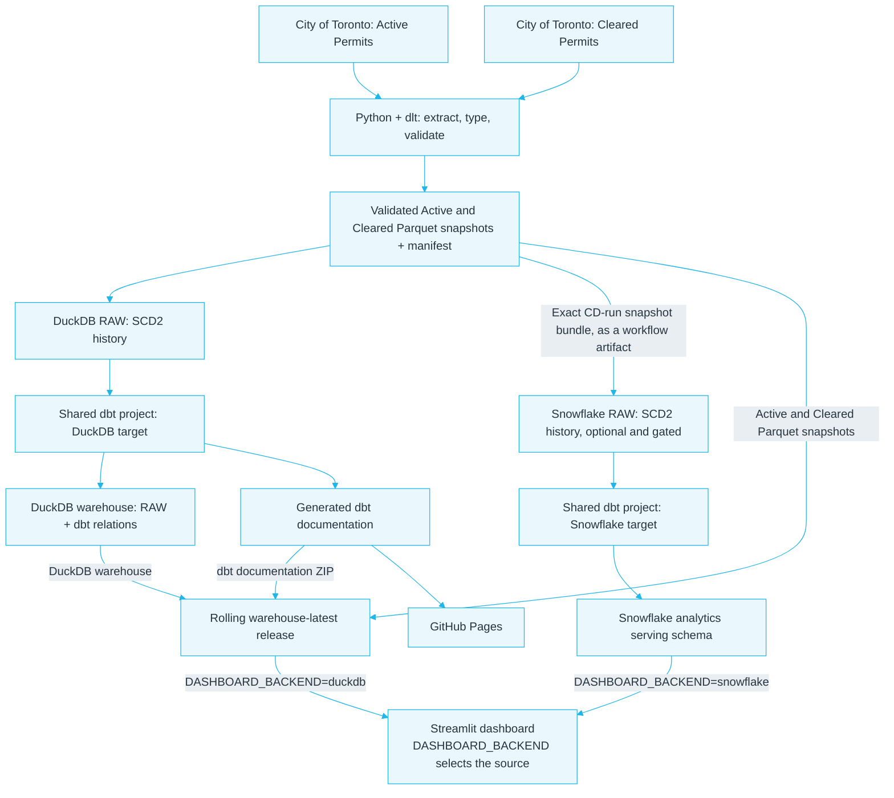
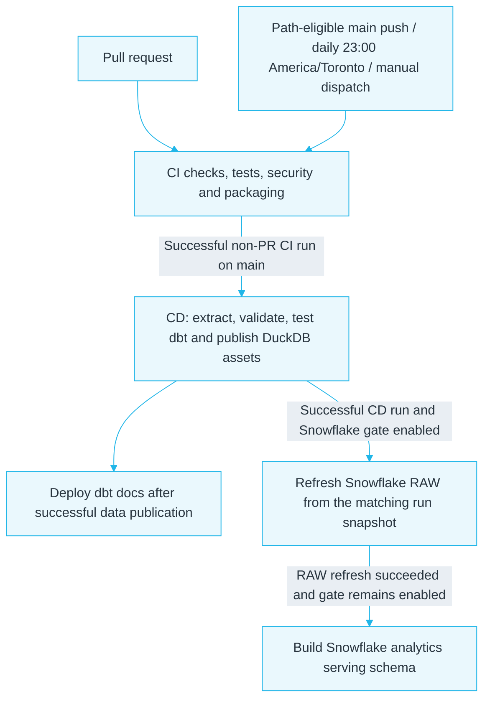

# Toronto Housing Bottleneck Analytics — Snowflake + DuckDB

An end-to-end Analytics Engineering project using City of Toronto building-permit data, with **DuckDB as the default warehouse backend and Snowflake as an optional second backend**. A single Python + dlt ingestion pipeline validates source snapshots, and one shared dbt project builds analytical models for both backends; the deployed Streamlit dashboard can read from either warehouse.

**[Live dashboard](https://toronto-housing-bottleneck.streamlit.app/)** · **[dbt documentation](https://gagadanalyst.github.io/toronto-housing-bottleneck-analytics/)** · **[Source code](https://github.com/gagadanalyst/toronto-housing-bottleneck-analytics)** · **[Published DuckDB and snapshots](https://github.com/gagadanalyst/toronto-housing-bottleneck-analytics/releases/tag/warehouse-latest)**

## What the project demonstrates

| Area | What is implemented |
|---|---|
| Ingestion | Python, dlt, Toronto CKAN API extraction, retries, explicit source types, validation, and Parquet snapshots. |
| Warehouse history | SCD Type 2 tracking for source changes observed between ingestion runs. |
| Analytics engineering | One dbt project for DuckDB and Snowflake, with staging models, revision-level facts, dimensions, marts, contracts, tests, and documentation. |
| Reliability | Regression tests, freshness and completeness checks, a verified rolling-release publication with recovery safeguards, and separate CI/CD workflows. |
| Data product | A deployed Streamlit dashboard with explicit backend selection and read-only Snowflake access. |

The analysis is descriptive, not causal. It examines observed active-permit ages and dates recorded for permits marked `Closed`; it does not claim to explain why a permit took a given amount of time.

## Architecture



Each refresh extracts the two configured sources once and validates the resulting snapshots. DuckDB publication remains the routine CI/CD path. After an eligible successful main-branch CD run, the optional Snowflake chain can consume the exact snapshot bundle from that run, refresh `TORONTO.RAW`, and then build the analytics serving schema. Snowflake RAW was initialized from a baseline snapshot; subsequent refreshes extend observed SCD2 history rather than recreate a fresh baseline. `DASHBOARD_BACKEND` selects which backend the same dashboard reads; a connection failure is shown rather than silently substituting results from the other warehouse.

## Source scope and analytical design

The current ingestion scope is limited to two City of Toronto datasets: [Active Permits](https://open.toronto.ca/dataset/building-permits-active-permits/) and [Cleared Permits](https://open.toronto.ca/dataset/building-permits-cleared-permits/). Both source configurations use `warehouse_since: 2020-01-01` on `APPLICATION_DATE`; full-source Parquet snapshots are retained independently of that warehouse cutoff.

The project deliberately does not ingest Development Applications, Preliminary Zoning Reviews, or Address Points. Those were considered during discovery but remain deferred until profiling shows that their grain, identifiers, linkage coverage, and join cardinality support reliable analysis. The [dataset-scope decision record](docs/decisions/0001-dataset-scope.md) explains the trade-offs.

| Model | Grain and purpose |
|---|---|
| `stg_active_permits`, `stg_cleared_permits` | One row per raw SCD2 source version; casts source fields while retaining selected raw values and version metadata. |
| `fct_active_permit_revision` | One row per current logical revision keyed by `permit_num`, `revision_num`, and `permit_type`; consolidates duplicate physical rows and surfaces disagreements. |
| `fct_cleared_permit_revision` | Same logical key; preserves signed lifecycle intervals and exposes analysis durations only when non-negative. |
| `dim_date` | Continuous calendar date dimension for dates observed in the Cleared fact. |
| `dim_permit_type` | Distinct permit types observed in either source fact, tested against both revision facts. |
| `mart_active_permit_age` | Current Active revisions with age, an eligibility flag, and a reason-coded exclusion. |
| `mart_cleared_lifecycle_by_year_type` | Calendar-day lifecycle summaries by application year, permit type, and date pair; reports median, 90th percentile, maximum, counts, and negative intervals. |

The dimensions are separately modeled and tested; the serving marts are purpose-built outputs and do not imply that every dimension is joined into every mart. Strict dbt static analysis is enabled by default. The Cleared staging model keeps a documented baseline exception because the analyzer cannot resolve DuckDB's timezone expression without a verified semantics-safe alternative.

**Metric rules.** Active age is calendar days from `application_date` to dbt's `as_of_date` (normally derived from the run start, with a variable for reproducible comparisons). Missing or conflicting status/application dates, and terminal or exceptional statuses (`abandoned`, `cancelled`, `closed`), are excluded from the age cohort with reason codes. Cleared lifecycle measures compare application, issue, and completion dates for records marked `Closed`; negative intervals remain available for diagnosis but are excluded from published duration statistics. Measures are calendar days, not business days.

## Important findings and decisions

- **CKAN is not a stable row-count endpoint.** Observed source totals have changed between requests, and the JSON resource has returned HTTP 502; HTTP 409 and 500 responses have also been observed. Extraction retries and restarts a changing paginated pull, validates required columns and completed row counts, and fails safely rather than accepting an incomplete snapshot.
- **Source types are part of the data contract.** Explicit source-declared types and type hints protect identifiers and numeric-looking text—including values with leading zeros—from accidental conversion. Raw values are retained beside selected typed fields for inspection.
- **SCD2 versions should represent meaningful changes.** The logical revision key is `permit_num` + `revision_num` + `permit_type`. The tracked-row hash excludes CKAN's `_id` and normalizes selected numeric fields to avoid false versions caused by source identity or representation. Regression checks cover unchanged replay and a controlled tracked-attribute change ([SCD2 test PR](https://github.com/gagadanalyst/toronto-housing-bottleneck-analytics/pull/76)).
- **Snowflake starts from a fresh baseline.** The new `TORONTO.RAW` history was initialized from a complete validated snapshot. Old DuckDB SCD2 history was not migrated, and missed days were not reconstructed. Snowflake history records changes observed from this baseline forward; validity windows are bounded by ingestion observations and do not prove exact real-world transition times.
- **One extraction feeds both backends.** The same validated snapshot bundle is used for DuckDB and Snowflake. Both targets use the same dbt model definitions and business rules; only necessary warehouse-specific SQL is isolated. There are no parallel model trees or duplicated extraction pipelines.
- **A Snowflake failure must not take down DuckDB publication.** DuckDB, Parquet, and dbt documentation publication remain the normal CI/CD path. Snowflake work runs in separate, gated workflows. The release publisher verifies the assets, keeps a backup of the last-known-good publication, and attempts rollback if replacement fails; a recovery artifact is preserved if rollback also fails.
- **The dashboard and workflow gate are separate controls.** `DASHBOARD_BACKEND` chooses the dashboard's data source. The GitHub repository variable `SNOWFLAKE_OPERATIONS_ENABLED` controls whether Snowflake workflow jobs may run. Switching the dashboard to DuckDB alone does not disable GitHub Actions compute.

## Data-quality snapshot

These source and model counts describe the published DuckDB warehouse observed on **October 18, 2026**. They are a dated illustration of the checks, not expected permanent totals.

| Check | Observed value | Meaning |
|---|---:|---|
| Active source rows across SCD2 history | 101,598 | Includes current and expired versions. |
| Current physical Active rows | 99,149 | Before consolidating duplicate physical rows. |
| Logical current Active revisions | 99,145 | One per logical revision key. |
| Active revisions eligible for age analysis | 99,074 | After the published status/date rules. |
| Active revisions excluded from age analysis | 71 | 2 missing status; 69 terminal or exceptional status. |
| Active builder-name conflict groups | 4 | Conflicting values retained as diagnostics. |
| Current physical / logical Cleared revisions | 186,430 / 186,425 | Five excess physical rows after consolidation. |
| Cleared builder-name conflict groups | 5 | Conflicts are surfaced rather than arbitrarily resolved. |
| Cleared lifecycle-date conflict groups | 0 observed | No conflict found for the modeled lifecycle-date fields in that snapshot. |

## Validation evidence

The following results are tied to specific workflow runs and inputs; they are not guarantees about later refreshes.

| Validation | Evidence |
|---|---|
| Fresh-baseline SCD2 behaviour | The [successful Snapshot Baseline and Replay run](https://github.com/gagadanalyst/toronto-housing-bottleneck-analytics/actions/runs/40491637116), added in [PR #76](https://github.com/gagadanalyst/toronto-housing-bottleneck-analytics/pull/76), verified that an unchanged replay added no versions and a controlled `STATUS` change created the expected version. |
| DuckDB/Snowflake parity | [Run 40482009588](https://github.com/gagadanalyst/toronto-housing-bottleneck-analytics/actions/runs/40482009588), using `as_of_date=2026-10-27`: compared dimensions, facts, and marts had zero row-value mismatches, and dashboard summary metrics matched. Staging was compared on schema, grain/count, and semantic types rather than row by row. |
| Automatic refresh chain | On commit [`e8bb994`](https://github.com/gagadanalyst/toronto-housing-bottleneck-analytics/commit/e8bb994c8ec664d2da7d12d1c296a1b15da3dc49), [CI](https://github.com/gagadanalyst/toronto-housing-bottleneck-analytics/actions/runs/40622105661), [CD/publication](https://github.com/gagadanalyst/toronto-housing-bottleneck-analytics/actions/runs/40622186735), [canonical RAW refresh](https://github.com/gagadanalyst/toronto-housing-bottleneck-analytics/actions/runs/40622867433), and [serving build](https://github.com/gagadanalyst/toronto-housing-bottleneck-analytics/actions/runs/40623059248) all succeeded on **October 27, 2026, Toronto time**. RAW and serving runs triggered automatically in sequence. |
| Gate-off / DuckDB fallback | On October 28, 2026, the GitHub variable was set to `false`. [Manual CI](https://github.com/gagadanalyst/toronto-housing-bottleneck-analytics/actions/runs/40630130221) and [the resulting CD publication](https://github.com/gagadanalyst/toronto-housing-bottleneck-analytics/actions/runs/40630228426) succeeded on the same commit. The automatically triggered [RAW refresh](https://github.com/gagadanalyst/toronto-housing-bottleneck-analytics/actions/runs/40631433875) and [serving build](https://github.com/gagadanalyst/toronto-housing-bottleneck-analytics/actions/runs/40631450406) skipped as intended. The project owner confirmed the public dashboard loaded successfully after switching `DASHBOARD_BACKEND` to `duckdb`. |

For the parity run, `MART_ACTIVE_PERMIT_AGE` had 98,869 rows (98,798 eligible and 71 excluded), `FCT_CLEARED_PERMIT_REVISION` had 188,819 rows, and the lifecycle mart had 300 summary groups. The comparison covered 481,927 lifecycle date pairs before excluding three negative intervals from duration statistics. These counts belong to that isolated parity baseline, not a later canonical RAW refresh. The parity job on PR #82 was skipped because the Snowflake workflow gate was off during that PR; the separately linked parity run provides the comparison evidence.

## Automation, publication, and operating controls

The architecture diagram above describes the data path; this separate view shows the automated GitHub Actions path from validation through DuckDB publication to the optional Snowflake refresh. Separate manually dispatched baseline/replay, Snowflake dbt validation, and smoke workflows, plus gated pull-request parity, are described below but not drawn here.



- **CI** validates Python linting/formatting, tests, dependency security, packaging, and dashboard dependencies. Pull requests also build and test dbt against the latest published DuckDB warehouse and check documentation packaging. The daily CI schedule is **23:00 America/Toronto** so the subsequent CD source refresh runs in the late-night Toronto window, reducing exposure to observed CKAN API instability. The schedule uses the `America/Toronto` IANA timezone to follow local time across daylight-saving changes. Main-branch push triggers are path-filtered, and manual dispatch is available. Late-night timing does not replace retries, completeness checks, or snapshot validation; it cannot guarantee upstream API availability.
- **CD** runs only after successful eligible CI on `main` and checks out that exact commit. It extracts and validates both sources, runs SCD2/warehouse checks and dbt tests, and publishes the rolling assets. Hosted dbt documentation deploys only after successful data publication. The Snowflake refresh consumes the validated snapshot bundle from that CD run, rather than extracting the sources again.
- **Rolling release** `warehouse-latest` contains the DuckDB warehouse, Active and Cleared Parquet snapshots, and a dbt documentation ZIP. It is a replaceable latest release—not a versioned history of immutable warehouse states. The validated snapshot bundle used by automatic Snowflake refresh is a workflow artifact, not an additional release asset.
- **Snowflake gate.** The exact repository variable value `SNOWFLAKE_OPERATIONS_ENABLED=true` enables the guarded jobs in `snowflake-canonical-raw-refresh.yml`, `snowflake-serving-schema.yml`, `snowflake-dbt.yml`, `snowflake-live-ingestion-smoke.yml`, `snowflake-parity.yml`, and `snowflake.yml`. If false or unset, the guarded jobs skip before connecting; a workflow record marked `skipped` is expected. The gate does not cancel a job already running. Pull-request parity can consume Snowflake compute when the gate is enabled.

For a trial-end or planned shutdown, set `SNOWFLAKE_OPERATIONS_ENABLED` to `false` or remove it; separately set the deployed Streamlit `DASHBOARD_BACKEND` to `duckdb`; verify the public dashboard loads the published DuckDB asset and a fresh DuckDB publication succeeds; inspect and stop/wait for any already-running Snowflake jobs; then remove unused Snowflake credentials. Trial expiry and resource monitors are not substitutes for disabling the workflow gate. See the [Snowflake operations guide](infra/snowflake/README.md) for account setup, role grants, manual workflow conditions, secrets, and verification steps.

**Gate-off validation completed on October 28, 2026.** With `SNOWFLAKE_OPERATIONS_ENABLED=false`, the manual CI run and subsequent DuckDB CD publication succeeded, while the automatically triggered Snowflake RAW refresh and serving build skipped. The project owner also confirmed that the public dashboard loaded successfully after changing `DASHBOARD_BACKEND` to `duckdb`. This demonstrates that Snowflake can be disabled without changing the DuckDB publication path. For a future planned shutdown, still check for already-running Snowflake jobs and verify the exact account trial end in Snowsight; trial expiry and resource monitors are not substitutes for the workflow gate.

## Repository security and local credentials

The `secret-scan.yml` workflow runs Gitleaks on pull requests, pushes to `main`, manual dispatches, and a weekly schedule. Local Streamlit secrets (`.streamlit/secrets.toml`) and common private-key file extensions are ignored by Git. The ignore rules do not remove files already committed.

For a deliberate local file and full-history audit, install Gitleaks and run:

```bash
gitleaks dir . --redact
gitleaks git . --redact --log-opts="--all"
```

If a real credential is detected, treat it as exposed and rotate/revoke it; deleting the line from the latest revision is not enough to make a historical secret safe.

## Live dashboard

**[Open the dashboard](https://toronto-housing-bottleneck.streamlit.app/)**. As verified on October 28, 2026, the public deployment is currently configured to query the published DuckDB release; a local run also defaults to DuckDB if `DASHBOARD_BACKEND` is omitted. The optional Snowflake backend remains available by explicitly setting `DASHBOARD_BACKEND` to `snowflake` and configuring its read-only credentials. Both paths query analytics relations rather than calling Toronto CKAN directly. Results are cached for 24 hours, with a manual refresh option. The sidebar's last-successful-refresh timestamp is displayed in Toronto local time (ET) and comes from the last successfully published DuckDB artifact or the Snowflake refresh-metadata table. If a DuckDB refresh fails before publication, its unpromoted timestamp does not replace the timestamp in the published artifact. The dashboard has four sections:

- **Overview** — high-level active-age and closed-permit lifecycle summaries.
- **Active permits** — age distributions and comparisons by permit type, including record-level detail.
- **Permits marked Closed** — lifecycle date-pair comparisons by application year and permit type.
- **Data & definitions** — eligibility, exclusions, data-quality checks, metric definitions, and caveats.

The dashboard distinguishes within-group summary statistics from statistics across individual revisions; a median of group medians is not presented as the median of all permits.

## Review the project locally

Python **3.14.x** is used for ingestion and tests. From the repository root:

```bash
git clone https://github.com/gagadanalyst/toronto-housing-bottleneck-analytics.git
cd toronto-housing-bottleneck-analytics
python3.14 -m venv .venv
source .venv/bin/activate
python -m pip install --upgrade pip
python -m pip install -e ".[dev]"
python -m pytest -q \
  --ignore=tests/test_warehouse_load.py \
  --ignore=tests/integration/test_scd2_active_permits.py
```

That test command is intended to run without a locally extracted Toronto dataset or warehouse. Other tests may require captured data, a warehouse, or network access; see the [test guide](tests/README.md). The full end-to-end setup test downloads a source dataset and should be run deliberately.

To build dbt against the latest published warehouse, use a **separate dbt virtual environment** and a copy of the database so you do not modify the downloaded release asset:

```bash
mkdir -p data/warehouse "$HOME/.venvs"
curl -fL \
  https://github.com/gagadanalyst/toronto-housing-bottleneck-analytics/releases/download/warehouse-latest/toronto.duckdb \
  -o data/warehouse/toronto.duckdb
cp data/warehouse/toronto.duckdb data/warehouse/toronto-dbt-local.duckdb
export DBT_DUCKDB_PATH="$PWD/data/warehouse/toronto-dbt-local.duckdb"
python3.14 -m venv "$HOME/.venvs/toronto-housing-dbt"
source "$HOME/.venvs/toronto-housing-dbt/bin/activate"
python -m pip install --upgrade pip
python -m pip install -r dbt/requirements.txt
cp dbt/profiles.yml.example dbt/profiles.yml
cd dbt
dbt deps --profiles-dir .
dbt build --profiles-dir .
dbt docs generate --profiles-dir . --output-dir target/docs-site
cd ..
```

Serve `dbt/target/docs-site` with `python3 -m http.server 8000` from that directory to view the generated docs at `http://localhost:8000/`.

To run the dashboard locally, create a separate environment for its pinned dependencies:

```bash
python3.14 -m venv "$HOME/.venvs/toronto-housing-dashboard"
source "$HOME/.venvs/toronto-housing-dashboard/bin/activate"
python -m pip install -r dashboard/requirements.txt
streamlit run dashboard/app.py
```

The local dashboard downloads the published DuckDB asset and therefore needs network access. To use Snowflake locally, configure `DASHBOARD_BACKEND` and the `[snowflake]` values in Streamlit secrets; never commit private keys or passphrases.

## Repository guide

| Path | Purpose |
|---|---|
| `src/toronto_housing_ingestion/`, `open_data_config.yml` | Extraction, validation, source typing, and warehouse loading. |
| `tests/` | Unit/integration tests, source-fallback tests, warehouse checks, and SCD2 regressions. |
| `dbt/models/staging/` | Source staging, type normalization, metadata, docs, and tests. |
| `dbt/models/marts/`, `dbt/macros/` | Facts, dimensions, marts, tests, and minimal adapter-specific SQL. |
| `.github/workflows/ci.yml`, `cd.yml` | Validation, production extraction, dbt builds, rolling publication, and docs deployment. |
| `.github/workflows/snowflake*.yml` | Optional gated Snowflake baseline, refresh, serving, smoke, and parity workflows. |
| `.github/workflows/secret-scan.yml` | Gitleaks checks for secrets on PRs, main pushes, manual dispatch, and weekly schedule. |
| `dashboard/app.py` | Streamlit data product with explicit backend selection. |
| `infra/snowflake/` | Snowflake setup SQL and operating guide. |
| `docs/decisions/0001-dataset-scope.md` | Dataset-selection rationale and gates for expanding source scope. |

## Limitations and deliberate non-goals

- **Active ages are right-censored:** the final issue or completion date is not yet known from an active record.
- **The `Closed` cohort is selected by recorded status:** it is not a complete or unbiased sample of all applications, especially for recent application years. 2026 is partial.
- **Durations are calendar days:** negative intervals remain diagnostic but are excluded from summaries.
- **SCD2 is observed history, not a complete event ledger:** changes between snapshots and exact real-world status-transition times cannot be inferred.
- **The release rolls forward:** it does not preserve every previous warehouse version as an immutable archive.
- **No causal claims:** the available fields do not establish why a permit took longer.
- **Deferred work:** additional datasets, historical DuckDB-to-Snowflake SCD2 reconciliation, a new orchestration framework, parallel dbt model trees, and a dbt Semantic Layer are outside the current scope. A semantic layer may be considered once metric definitions and consumption needs are stable.

## Project timeline and development practice

The earliest preserved artifacts date to **September 27, 2026 (UTC)**; the first public Git commit was **October 4**. Ingestion and core checks came first. GitHub Actions publication was added in mid-October; dbt pull-request validation, the Streamlit dashboard, hosted docs, and the CI/CD split followed on October 18 ([CI run](https://github.com/gagadanalyst/toronto-housing-bottleneck-analytics/actions/runs/39179649087), [CD run](https://github.com/gagadanalyst/toronto-housing-bottleneck-analytics/actions/runs/39179772013)). Late October brought the fresh Snowflake baseline, same-snapshot parity validation, explicit dashboard backend selection, and automatic RAW/serving refresh. The progression from preserved artifact to deployed dashboard was about three calendar weeks, not a claim about hands-on hours.

### AI-assisted development and ownership

I owned the project requirements, scope, acceptance criteria, and final decisions on architecture and technical trade-offs across ingestion, SCD2 history, dbt, CI/CD, and the optional Snowflake path. I used LLMs as development aids to research unfamiliar concepts and APIs, compare implementation options, draft and refine code and documentation, and troubleshoot failures.

I reviewed and adapted AI-generated suggestions rather than treating them as authoritative. I verified behaviour through tests, dbt and data-validation queries, GitHub Actions results, and checks of the deployed dashboard and workflow outcomes. The final implementation decisions, validation, and documented limitations remain my responsibility.
