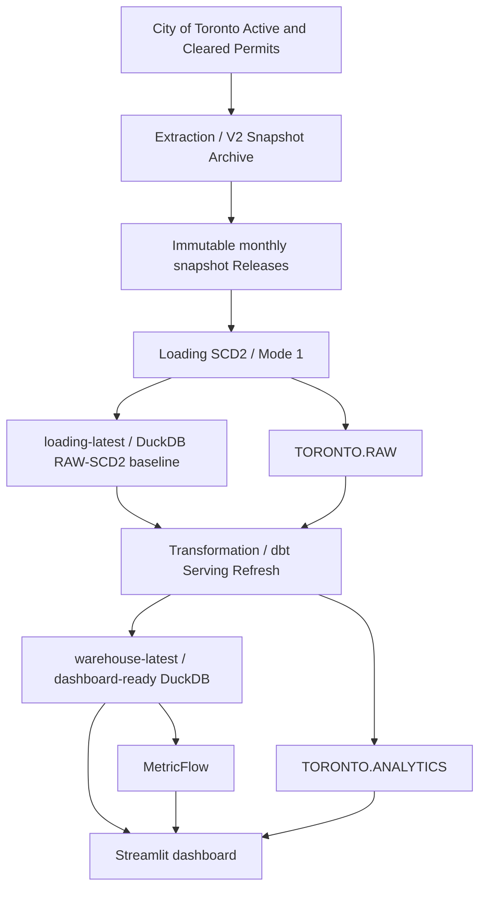

# Extraction, Loading and Transformation

> **Current operating status (November 2026):** DuckDB is the active backend for GitHub Actions publication and recovery. Snowflake-specific workflows and jobs were retired and removed from active automation in November 2026 after the trial expired. The diagram and Snowflake descriptions below preserve the former dual-backend implementation.

The production data path has three independent stages and one orchestrator.
Each stage owns its own promotion boundary and can be run on demand.

## Stage ownership

**Extraction / V2 Snapshot Archive** fetches Active and Cleared Permits,
validates the paired snapshot, publishes an immutable monthly Release asset,
and updates `snapshot_inventory.json`. It does not write either warehouse or
run dbt.

**Loading SCD2 / Mode 1 Incremental Loader (Validated Staging)** consumes
approved, unprocessed archives. Historically, it staged and validated DuckDB and optional
Snowflake RAW candidates, then promoted each backend independently. It performs
source, ledger, DLT, SCD2, business-key, quarantine and baseline validation;
it does not run dbt. DuckDB loading state is published to `loading-latest`,
containing `toronto-loading.duckdb` and the latest approved Active/Cleared
Parquet assets. The first Loading run seeds this release once from the existing
verified `warehouse-latest`; subsequent Loading runs use only `loading-latest`.

**Transformation / dbt Serving Refresh** restores the promoted `loading-latest`
generation, runs dbt build/tests, generates documentation, verifies dashboard
relations and refresh metadata, then publishes the complete four-asset
`warehouse-latest` release. Failed Transformation leaves the previous complete
dashboard warehouse unchanged. A dbt-only run does not replay SCD2. Its former Snowflake job dispatched the existing isolated `ANALYTICS_STAGE_*` build only
after a successful RAW promotion, or during an explicit dbt-only refresh when
`SNOWFLAKE_OPERATIONS_ENABLED=true`. That workflow has since been retired; the
Snowflake backend implementation remains supported.

**Complete Pipeline / Extraction + Loading + Transformation** starts at 11 PM
`America/Toronto` or through explicit manual dispatch. When scheduled Extraction
is enabled it starts Extraction; Loading follows its completion regardless of
outcome, so failed or no-change extraction does not block older approved
archives. When the Extraction schedule gate is off but Loading schedule gates
remain enabled, the orchestrator starts Loading directly so existing approved
archives can still be processed. Transformation follows a successful, validated Loading handoff. This includes the applicable initial-baseline persistence and Mode 2 rebootstrap paths; a Loading run without a validated handoff does not trigger Transformation.

**Mode 2 full-history recovery** remains a separate manual replay and explicit
promotion path. Run Loading once after deploying this split so `loading-latest`
exists before starting Mode 2 replay. Replay reads that baseline without
publishing production assets; the separately confirmed promotion updates
DuckDB's `loading-latest` and reboots its persistent Loading state. The former
implementation also supported a separate Snowflake Loading state.

**MetricFlow Semantic Metrics** follows Transformation completion and publishes
only after a successful DuckDB `warehouse-latest` publication. It remains
DuckDB-only and writes its separate `metrics-latest` JSON package.

## Trigger matrix

| Event | First stage | Downstream |
|---|---|---|
| Scheduled Complete Pipeline (Extraction enabled) | Extraction | Loading → Transformation after a successful, validated Loading handoff → MetricFlow after DuckDB publication |
| Scheduled Complete Pipeline (Extraction disabled, Loading enabled) | Loading | Transformation after a successful, validated Loading handoff → MetricFlow after DuckDB publication |
| Manually confirmed Complete Pipeline | Extraction | Loading → Transformation after a successful, validated Loading handoff → MetricFlow after DuckDB publication |
| Manual Extraction | Extraction | Loading → Transformation after a successful, validated Loading handoff |
| Manual Loading | Loading | Transformation after a successful, validated Loading handoff |
| Extraction-specific code changes | Extraction | Loading → Transformation after a successful, validated Loading handoff |
| Loading/replay/SCD2 code changes | Loading | Transformation after a successful, validated Loading handoff |
| dbt model/macro/test/project changes | Transformation | No upstream extraction or loading |
| Manual Transformation | Transformation | No SCD2 replay |
| Dashboard-only changes | CI | No warehouse pipeline |

## Recovery boundaries

- Extraction failure: no incomplete archive is approved; Loading still checks older archives.
- Loading failure before promotion: the prior loading baseline remained authoritative; this also applied to canonical Snowflake RAW in the former Snowflake path.
- Loading promotion succeeds but publication fails: inspect the validated Mode 1 checkpoint and immutable recovery evidence; retry Loading, not Transformation.
- Transformation failure: `loading-latest` remains available; the previous `warehouse-latest` remains active. In the former Snowflake path, promoted `TORONTO.RAW` and the previous `TORONTO.ANALYTICS` also remained available. Retry Transformation only.
- Backend failure: historically, DuckDB and Snowflake promoted independently; a successful backend was not rolled back because the other failed.

## Post-implementation validation checklist

- [ ] Loading publishes the validated `loading-latest` baseline without changing `warehouse-latest`; a subsequent Loading run restores `loading-latest`.
- [ ] Extraction failure and no-change runs still trigger Loading, which checks previously approved, unprocessed archives.
- [ ] SCD2, ledger, DLT, quarantine, provenance and production-baseline checks pass; Mode 2 promotion updates DuckDB's `loading-latest` and reboots its persistent Loading state.
- [ ] Transformation restores the intended Loading generation, passes dbt build/tests and dashboard-relation/metadata checks, then publishes `warehouse-latest`; a failed refresh leaves the previous serving release unchanged.
- [ ] Historically, Snowflake RAW and ANALYTICS were independent promotion boundaries; a serving retry did not replay RAW.
- [ ] MetricFlow runs only after successful DuckDB Transformation publication; manual, code-path and complete-pipeline triggers work, including the 11 PM `America/Toronto` schedule.

`DASHBOARD_BACKEND` continues to select the dashboard warehouse.
`SNOWFLAKE_OPERATIONS_ENABLED` was the operational gate for the former Snowflake workflows; it no longer controls an active GitHub Actions path and does
not select the dashboard backend.
