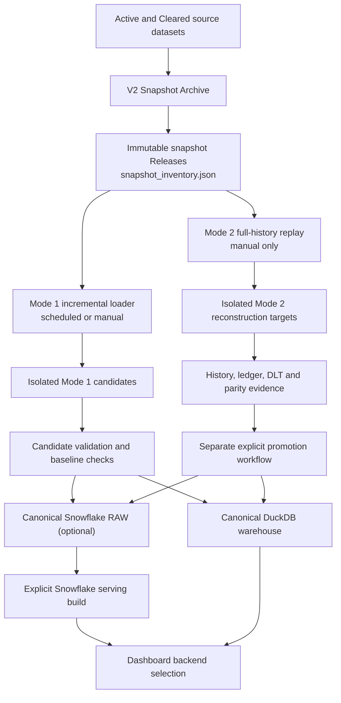

# Snapshot archives, Mode 1 loading, and Mode 2 recovery

This runbook describes the current separation between immutable source extraction,
incremental production loading, full-history reconstruction, and explicit
production promotion.

The source archive is the durable input record. Mode 1 is the routine incremental
production path. Mode 2 reconstructs the retained archive history in isolated
targets and produces evidence; a separate promotion workflow is required before
that reconstructed generation can replace production.

## Architecture



## 1. Immutable source archive

The standalone extraction application and `v2-snapshot-archive.yml` workflow
discover, extract, type, and validate the two configured sources:

- City of Toronto Active Building Permits.
- City of Toronto Cleared Building Permits.

A successful archive publication retains a validated bundle in a monthly-tagged
immutable GitHub Release and updates `snapshot_inventory.json`. The V2 archive
workflow does not load DuckDB, write Snowflake RAW, build dbt models, or promote a
warehouse. Archive retention is independent of Mode 1 and Mode 2 warehouse
operations.

The scheduled archive run is at 10:17 UTC and requires
`TORONTO_EXTRACTION_SCHEDULE_ENABLED=true`. A deliberate manual publication
requires `TORONTO_EXTRACTION_ENABLED=true`, `confirm_publish=true`, and the
`main` branch. The workflow checks whether the source data changed before it
extracts and publishes a new snapshot.

The replay implementation can consume the retained archive formats it recognizes.
The current extraction workflow creates V2 bundles; historical V1 archive Releases
remain part of the retained evidence where present. Do not edit immutable Release
assets to repair a warehouse.

## 2. Mode 1 — incremental production loading

The production loader is `.github/workflows/mode1-incremental-loader.yml`,
named `Mode 1 Incremental Loader (Validated Staging)`. It is the routine
incremental loading path. Its scheduled run is at 13:00 UTC. Scheduled execution
requires both:

- `TORONTO_MODE1_ENABLED=true`
- `TORONTO_MODE1_SCHEDULE_ENABLED=true`

Manual dispatch is restricted to `main` and accepts a backend selection:
`duckdb`, `snowflake`, or `both`. The Snowflake job additionally requires
`SNOWFLAKE_OPERATIONS_ENABLED=true`. The Mode 1 workflow refuses to continue if
the retired `TORONTO_SNAPSHOT_LOADER_ENABLED` variable is `true`; keep that old
variable false or unset. It is a fail-closed compatibility guard, not the
activation switch for Mode 1.

### Candidate and state lifecycle

Mode 1 does not load new snapshots directly into canonical production.

For DuckDB, it restores the current published warehouse (or a verified immutable
recovery checkpoint when required), captures a production baseline, restores
the accepted Mode 1 working state, and replays only unprocessed approved archives
into an isolated candidate. The candidate then goes through source, SCD2,
quarantine, baseline, and dbt validation. The production baseline is checked
again before promotion. After a successful promotion, the workflow publishes
the rolling DuckDB, Parquet, and dbt documentation assets.

For Snowflake, Mode 1 captures the canonical RAW baseline and stages work in a
run-scoped clone of `TORONTO.RAW`. It restores the accepted Mode 1 state and
replays only unprocessed archives into that candidate. After source, ledger,
DLT, SCD2, quarantine, and baseline checks pass, the candidate is promoted
through the guarded RAW swap. The workflow then explicitly dispatches
`snowflake-serving-schema.yml` with its own `snapshot_loader_run_id`.

The backend jobs are independent. A Snowflake failure does not undo a successful
DuckDB promotion, and a DuckDB failure does not roll back Snowflake. There is no
distributed transaction across the two warehouses.

### Persistent Mode 1 state

Mode 1 working state is retained using the `toronto-mode1-working-state`
Release tag. DuckDB working state is stored in immutable Release assets.
Snowflake keeps its live working schema in Snowflake; the corresponding replay
ledger and schema pointer are retained in the state Release.

The state preserves per-source progress and supports retry after partial source
loads. A failed candidate is not promoted and must not be treated as the next
production baseline. Do not manually edit, delete, or substitute the persistent
state assets to get past a failed validation.

The first Mode 1 bootstrap can reference a successful accepted Mode 2 full-history
replay run using `baseline_run_id` and `baseline_attempt`. The
`rebootstrap_from_mode2` input deliberately discards the previous Mode 1 state
and bootstraps from the selected accepted Mode 2 generation. Use it only as an
intentional recovery/rebootstrap operation after reviewing the selected history.

### Mode 1 promotion conditions

Before production promotion, the loader validates the staged source inputs and
the candidate generation. Checks include required source columns and schema,
snapshot completeness, row counts, business-key integrity, duplicate-key
handling, tracked-row changes, replay-ledger completeness, SCD2 interval
integrity, current-key uniqueness, quarantine reconciliation, and the captured
production baseline.

For Snowflake, RAW and the serving schema are separate promotion boundaries.
A successful RAW swap does not imply that dbt serving has been promoted. If
serving fails after RAW succeeds, retry only the serving workflow after verifying
the successful RAW generation.

## 3. Mode 2 — isolated full-history reconstruction

Mode 2 is `.github/workflows/snapshot-replay.yml`, named
`Snapshot Loader (Full-History Rebuild and Parity)`. It is manual-only; it has no
daily schedule and is not the routine production loader.

Mode 2 replays the selected retained immutable archive history into run-scoped
isolated targets. Backend selection is independent: DuckDB replay can run without
Snowflake, while Snowflake replay and the joint parity comparison require
`SNOWFLAKE_OPERATIONS_ENABLED=true`. Optional date bounds and an archive limit
allow a deliberate subset to be reconstructed. Without those bounds, the replay
uses the full retained archive selection.

The workflow preserves its rebuild ledger, replay summaries, and evidence
artifacts so retries and saved-evidence comparisons can be performed without
writing to production. Its DuckDB and Snowflake job names remain:

- `Load DuckDB (rebuild)`
- `Load Snowflake (rebuild)`

When both backends are selected and Snowflake is enabled, the compare job
validates the reconstructed SCD2 histories. The Mode 2 workflow produces
reconstruction evidence only. It does not replace the current DuckDB warehouse,
promote Snowflake RAW, or dispatch the serving workflow.

## 4. Explicit Mode 2 production promotion

`.github/workflows/promote-snapshot-rebuild.yml` is the separate full-history
promotion workflow. It is manually dispatched and requires
`confirm_full_history_promotion=true`.

Before promotion, it verifies the selected Mode 2 source workflow run and
attempt, the expected successful backend jobs and evidence artifacts, the
required history/parity evidence under the selected backend policy, and the
current production baselines. It then promotes the accepted full-history
generation. The DuckDB promotion is independent of the Snowflake promotion;
the Snowflake promotion leg is enabled only when
`SNOWFLAKE_OPERATIONS_ENABLED=true`.

The promotion workflow uses the shared production-publication concurrency lock.
It is intentionally separate from the isolated Mode 2 replay lock, so a long
historical reconstruction does not hold the production lock. Do not promote a
candidate by manually copying its database or schema into production.

After a successful Snowflake promotion, the promotion workflow explicitly
dispatches the serving workflow with `snapshot_rebuild_promotion_run_id`.
The serving workflow verifies that upstream promotion before it builds the
serving candidate.

## 5. Snowflake gate and dashboard backend

`SNOWFLAKE_OPERATIONS_ENABLED` is an operational workflow gate, not a secret and
not the dashboard backend setting.

When it is `false` or unset:

- The Mode 1 DuckDB job remains independent and can continue when Mode 1 itself
  is enabled.
- The Mode 1 Snowflake job skips.
- Snowflake serving operations skip.
- The Snowflake side of Mode 2 replay, joint comparison, and full-history
  promotion is not run.
- V2 source extraction and immutable archive publication remain independent.

The gate does not cancel a Snowflake job already running. Inspect in-progress
runs separately when disabling Snowflake.

`DASHBOARD_BACKEND` independently selects `duckdb` or `snowflake`. The dashboard
defaults to DuckDB when no override is set. Changing the dashboard backend does
not disable Snowflake workflows; changing the workflow gate does not change
the dashboard setting.

## 6. Historical baseline provenance

The accepted historical reconstruction used the 28 retained source snapshots
ending at archive identity `42022028625:1`. The isolated DuckDB/Snowflake
historical replay and parity evidence is retained in
[run 42547265259](https://github.com/gagadanalyst/toronto-housing-bottleneck-analytics/actions/runs/42547265259).
The separate production promotion is recorded in
[run 42562947635](https://github.com/gagadanalyst/toronto-housing-bottleneck-analytics/actions/runs/42562947635).

Those identifiers document the historical archive boundary and its promotion.
They are not a moving count for later incremental snapshots and are not a
replacement for current Mode 1 working state. Reconstructing all retained
archives still does not recover changes that occurred before the first retained
snapshot or between two source captures.

## 7. Quarantine and independent promotion guarantees

Rows with NULL/blank business keys and every row belonging to a conflicting
duplicate-key group are excluded from clean SCD2 and retained with the full
source record, physical Parquet row ordinal, row hash, archive identity, Release
asset, and Parquet checksum. Redundant identical duplicate occurrences are also
retained; the first identical record is loaded, and redundant occurrences do not
count toward the bad-row limit.

For a candidate generation, newly quarantined bad rows are aggregated across
all newly replayed archives for each source independently. Promotion is blocked
when that source total is **at least 25%** of its pre-run production current-row
count. Active and Cleared are checked separately. Quarantine rows already
present in the promoted baseline do not accumulate toward this test.

Rejected DuckDB candidates can publish quarantine rows to a separate audit
Release. That audit database is not a recovery checkpoint and must not be used
to restore production. Snowflake retains a rejected RAW candidate schema for
inspection. No historical quarantine backfill is performed; the immutable
snapshot archives remain the source record for earlier captures.

A successful promotion in one warehouse is not coupled transactionally to the
other. A failure in one backend does not automatically roll back a successful
promotion in the other. If a swap or rollback reports an ambiguous outcome,
stop and inspect the canonical and retained candidate generations before
attempting another write.

## 8. Recovery procedure

Choose the recovery action from the last successful promotion boundary, not
only from the overall workflow conclusion.

| Failure point | Production state | Recovery action |
|---|---|---|
| V2 extraction or archive validation fails before publication | No new approved archive is available to the loaders | Resolve the source/API or validation issue and rerun the archive workflow. Do not load an incomplete or unapproved bundle. |
| Mode 1 replay or candidate validation fails before promotion | The existing canonical backend remains active; retryable working state may contain partial per-source progress | Inspect the failed job and state evidence, then rerun the failed Mode 1 workflow attempt. Do not promote the rejected candidate or manually change its state. |
| Mode 1 DuckDB promotion succeeds but rolling publication fails | Inspect the immutable recovery checkpoint and the `warehouse-latest` Release assets separately | Use the verified recovery checkpoint and publisher recovery evidence. Do not substitute a rejected candidate or quarantine-audit database. |
| Mode 1 Snowflake RAW promotion succeeds but serving fails | Promoted `TORONTO.RAW` remains active; the prior `TORONTO.ANALYTICS` remains active until serving promotion | Retry only the serving workflow with the successful Mode 1 run ID, after checking that the RAW promotion is complete. |
| Mode 2 replay or parity validation fails | Canonical production is unchanged by the Mode 2 replay | Inspect the retained run artifacts, correct the issue, and rerun Mode 2 or validate the saved evidence. Do not invoke production promotion with incomplete evidence. |
| Mode 2 promotion fails or reports a rollback problem | DuckDB and Snowflake promotion outcomes may differ | Inspect each backend's last promotion boundary and retained candidate/recovery data. Stop if a swap or rollback outcome is ambiguous. |
| One backend succeeds and the other fails | Backends promote independently | Recover only the failed backend. There is no distributed transaction or automatic cross-backend rollback. |

### Useful commands

Rerun failed jobs from a Mode 1 workflow run:

```bash
gh run rerun MODE1_RUN_ID --failed --repo gagadanalyst/toronto-housing-bottleneck-analytics
```

Manually dispatch Mode 1 for a selected backend on `main`:

```bash
gh workflow run mode1-incremental-loader.yml --ref main -f backends=duckdb
```

For a deliberate Snowflake-only Mode 1 run, use `backends=snowflake`. The Mode 1 and Snowflake workflow gates must already be enabled.

Run a manual Mode 2 reconstruction:

```bash
gh workflow run snapshot-replay.yml --ref main -f backends=both
```

After reviewing the successful Mode 2 run and attempt, explicitly authorize its production promotion:

```bash
gh workflow run promote-snapshot-rebuild.yml --ref main -f source_run_id=MODE2_RUN_ID -f source_run_attempt=MODE2_RUN_ATTEMPT -f confirm_full_history_promotion=true
```

Retry serving after a successful Mode 1 RAW promotion:

```bash
gh workflow run snowflake-serving-schema.yml --ref main -f confirm_serving_schema=true -f snapshot_loader_run_id=MODE1_RUN_ID
```

Retry serving after a successful Mode 2 promotion:

```bash
gh workflow run snowflake-serving-schema.yml --ref main -f confirm_serving_schema=true -f snapshot_rebuild_promotion_run_id=PROMOTION_RUN_ID
```

If a loader/promoter run failed only because its serving-dispatch step failed, verify the intended generation is already canonical before using the deliberately manual serving path without an upstream run ID:

```bash
gh workflow run snowflake-serving-schema.yml --ref main -f confirm_serving_schema=true
```

Do not use an old canonical RAW refresh command or the removed legacy rebuild workflow. The current production paths are Mode 1 candidate promotion and the separately authorized Mode 2 promotion.

## 9. Disabling Snowflake

To stop Snowflake workflow operations while retaining DuckDB publication:

1. Set `SNOWFLAKE_OPERATIONS_ENABLED` to `false` or remove it, and verify the saved repository variable.
2. Set the deployed Streamlit `DASHBOARD_BACKEND` to `duckdb`, or remove its override to use the default.
3. Inspect in-progress Snowflake workflow runs; changing the gate does not cancel an already-running job.
4. Run or verify a successful Mode 1 DuckDB publication.
5. Confirm the Snowflake Mode 1 and serving jobs skip while the DuckDB path continues.
6. Confirm the public dashboard loads from the published DuckDB asset.
7. Remove unused Snowflake credentials only after the dashboard switch has been verified.

The V2 archive workflow is independent of Snowflake. Source snapshot retention and DuckDB production loading can continue with Snowflake disabled.
